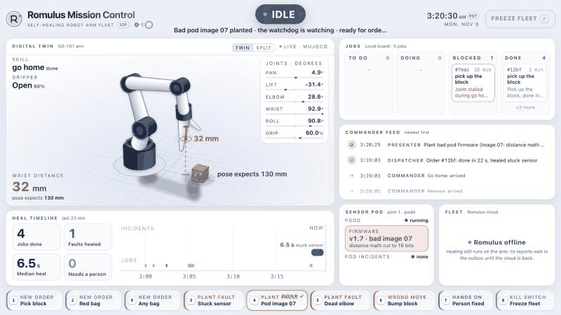
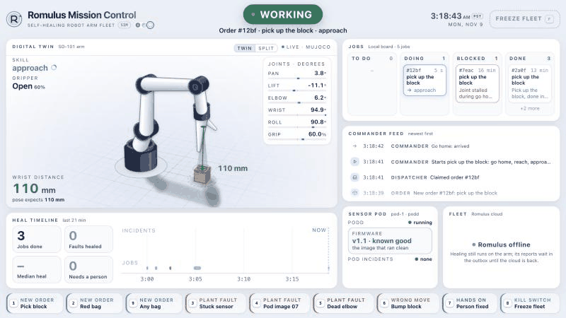

<p align="center">
  
</p>

<p align="center">
  <b>A self-healing operating system for robots and factory hardware, sold by a company that mostly runs itself.</b><br>
  Built at Y Combinator for the Naïve Autonomous Company Hackathon, Nov 7 to 8, 2026.
</p>

<p align="center">
  
  
  
  
  
</p>

<p align="center">
  <a href="#watch-the-demo"><b>Demo video</b></a> ·
  <a href="#how-it-works"><b>How it works</b></a> ·
  <a href="#the-numbers"><b>The numbers</b></a> ·
  <a href="#see-it"><b>See it</b></a> ·
  <a href="#how-the-pieces-fit"><b>How the pieces fit</b></a> ·
  <a href="#run-it"><b>Run it</b></a> ·
  <a href="#team"><b>Team</b></a>
</p>

**Autonomy, shown.** [How the pieces fit](#how-the-pieces-fit) follows the data from the arm to the Naïve and Hermes agents and back, in three animations:
- **A self-healing job:** after the order, nobody types. A stuck sensor parks the arm, and Hermes heals it.
- **A real-arm try from Nov 8,** when an LLM planned 96 of the 102 tries.
- **Fleet learning:** a Naïve agent turned two heals into a skill that the gate promoted to the fleet 57 s later, with 0 human clicks.

## Watch the demo

[][demo]

<p align="center"><sub>Click to watch on Google Drive.</sub></p>

## The problem

The world's 500 biggest companies lose almost **$1.4 trillion a year** to unplanned downtime, about 11% of their revenue ([Siemens, *The True Cost of Downtime 2024*][siemens]). A lot of that is machines breaking where nobody can reach them. Andre has seen it with satellites and a ground station on Guam: a short contact window, no internet, and a fault that costs millions because nobody can log in to fix it.

Robots have the same problem on a smaller scale. When an arm on a line crashes, someone gets paged, walks over with a laptop and reads logs. If the robot is offline it just stays broken, and whatever it saw when it failed is gone.

Our bet is that small local models can now do first-line repair on their own. They can read the logs, find the bad change, fix it, check the fix, and call a person only when the job needs hands.

## How it works

<p align="center">
  
</p>

Hardware Buddy runs one heal loop at three sizes. Each time, a model proposes a fix that can be undone, plain code checks it, and the fix is promoted or rolled back. No model ever sits in the real-time control loop.

| Scale | What happens | Where it lives |
|---|---|---|
| **The robot** | A local model fixes software faults with no internet. For a hardware fault, it parks the arm and reports. | [`firmware/`](firmware/README.md), [`device/`](device/README.md), [`arm/`](arm/README.md) |
| **The fleet** | Back online, the robot syncs to **Romulus**, our cloud. Fixes that hold are replayed, tried on a simulated canary and shipped to every robot. | [`cloud/`](cloud/README.md), [`tools/edge_bridge/`](tools/edge_bridge/README.md) |
| **The company** | Naïve agents take the cases software can't fix. They diagnose, email a technician, stage the part and write new skills for the fleet. | [`docs/naive-technician/`](docs/naive-technician/README.md), [`docs/recursive-self-improvement/`](docs/recursive-self-improvement/README.md) |

### 1. On the robot: it heals its own firmware, offline

<p align="center">
  
</p>

That's a real run on our bench, with no internet and nobody touching anything ([`firmware/harness/RESULTS.md`](firmware/harness/RESULTS.md), run `20261108-000512-arm07-ollama`).

We flashed the sensor pod with v1.7, a release with a bug planted in its distance math. The pod started seeing obstacles that weren't there, so the arm's obstacle reflex kept firing. It flailed for 8 seconds and the job gave up. Then the healer, `qwen3.5:4b` running locally through Ollama, took over with the pod's heal tools:

- **At 46 s** it had rolled the firmware back to v1.0 and verified it on the chip.
- **At 72 s** it had re-run the operator's job on its own: exit 0, 663 of 663 frames, every joint reaching 97 to 99% of its commanded range.
- **At 141 s** it had found the root cause, a 16-bit cast on line 122 of `hcsr04.c`, and written it down.

```diff
@@ src/hcsr04.c:122 · the line the healer traced (v1.7 → v1.0) @@
-        out->dist_mm = (uint16_t)(us * 343u + 1000u) / 2000u;   /* us * 0.343 mm/us / 2, rounded */
+        out->dist_mm = (us * 343u + 1000u) / 2000u;   /* us * 0.343 mm/us / 2, rounded */
```

The cast cuts the value to 16 bits before the divide, so something 376 mm away reads as 15 mm. The whole run took twelve turns and ten tool calls (eight reads, one flash, one arm job) with zero errors. The one call it wasn't allowed to make, a git commit, was refused by the harness.

<details>
<summary><b>Why it's safe to let a model flash firmware</b></summary>
<br>

- **Tools, not a shell.** The agent only gets the pod's 38 heal tools, and each one has a risk level: `read`, `runtime`, `code`, `flash` or `notify` ([`firmware/healer/`](firmware/healer/README.md)). The harness caps flashes at 3 per run and refuses paths outside the workspace ([`firmware/harness/`](firmware/harness/README.md)).
- **Every flash can undo itself.** `fw_flash` backs up the chip, programs it, verifies it, watches it, and rolls back on its own if the new image misbehaves.
- **Faults can't be planted from inside.** Fault injection is for the operator only, and `pod_cmd` refuses `inject`.
- **Software gets fixed, hardware gets parked.** For a hardware fault the arm is parked with torque off, a person is told, and no code changes.
- **No hints.** Before the bench run above, [`arm/hint_audit.py`](arm/hint_audit.py) checked everything the agent could read and found nothing that gives the answer away.

</details>

<details>
<summary><b>How we picked the model</b></summary>
<br>

We planted six faults in the robot app: a fake "safety" rule, a missing validity check, dropped servo retries, a config typo, a hang, and a missing servo that has to be parked, not patched. A hidden check the healer never sees scores each one. All runs used harness h3 on a MacBook with Ollama, capped at 30 steps and 15 minutes per task ([`docs/healer-benchmark-progress.md`](docs/healer-benchmark-progress.md), [`bench/`](bench/README.md)).

| Model | Passed | Live demo fault (D1) | Median time per task |
|---|---|---|---|
| **qwen3.5:4b, thinking on** | **10 / 12** | **2 / 2** | 105 s |
| qwen3.5:4b, thinking off | 7 / 10 | 0 / 2 | 63 s |
| qwen3:4b-instruct-2507 | 3 / 6 | 0 / 1 | 104 s |
| granite4.1:3b | 1 / 6 | 0 / 1 | 180 s |

At 3.3 GB, `qwen3.5:4b` fits on the edge box. For comparison, the big cloud agents (Naïve's `pi` and Hermes, both on gpt-6-sol) fixed 12 of 12 on a stand-in version of the same six faults ([`prototypes/fault-lab/`](prototypes/fault-lab/README.md)).

</details>

### 2. When it needs hands: a Naïve agent takes the case

<p align="center">
  
</p>

Some faults can't be fixed in software, and a robot can't pull out its own jam. When the healer gives up on a hardware fault, Romulus opens a work order and the **Naïve Technician** takes it ([`docs/naive-technician/`](docs/naive-technician/README.md)):

1. A `technician` agent session on Naïve diagnoses the fault and returns a typed report: a verdict, ranked hypotheses with physical checks, and an optional spare part.
2. Plain code acts on the report. It emails the technician from the agent's own Naïve inbox, checks the part against the vendor's live store, and builds a real cart link.
3. A person approves the purchase. It's the one step we keep human.

In the live rehearsal at 8:44 AM it took **38 s** from incident to a case waiting for approval, one **27 s** Naïve session that cost **$0.08**, a real email to a teammate, and the spare servo staged at $15.99.

### 3. Across the fleet: every fault happens once

<p align="center">
  
</p>

Back online, every robot syncs its incidents and heal runs to Romulus. Each heal gets labelled by whatever checked it (the gate, the device or a bench test), never by a model's opinion. When one kind of fault keeps failing across the fleet, a Naïve agent reviews the cluster and proposes a fix ([`docs/recursive-self-improvement/`](docs/recursive-self-improvement/README.md)):

- A **missed detection** becomes a proposed rule.
- A **failed heal** becomes a proposed skill for the healer.
- Either one ships only through the same gate as every other change: a replay against past incidents, a canary on a simulated arm, then promote or roll back.

In the live run at 10:04 AM, a `fleet-doctor` session read a failed heal on sim-1 and a passing one on sim-3, then wrote the skill *"Servo read error: check the retry call site, not the config"* in 22 s for 3¢. The gate replayed it, ran a 32.5 s canary on sim-2, and promoted it to every arm **57 s after the session opened, with 0 human clicks**. The healer's playbook went to Naïve Skills as v2.

The other session that morning proposed a frozen-sensor rule. Offline, it caught 120 of 120 sensor freezes lasting 4 seconds or more (the fleet catches 0 today), with no new false alarms on 410 healthy windows. But the rule touches the arm's start gate, so it was staged for Olir to review instead of shipping. The agent knows where its autonomy stops:

| Change | Decided by | Human clicks |
|---|---|---|
| Dataset snapshots and training exports | plain code | 0 |
| A new rule or skill that doesn't touch safety | the gate: replay, simulated canary, promote or roll back | 0 |
| Anything that touches safety | its owner, with the measured evidence attached | 1 review |
| Spending money | a person | 1 click |

A rolled-back proposal pauses reviews for that fault until a person clears it. Every kind of action earns its autonomy, and loses it after a bad fix.

## The numbers

<p align="center">
  
</p>

Every number above was measured, not estimated:

| What | Number | Source |
|---|---|---|
| Real arm on bad firmware, healed with no internet and no humans | 141 s (rollback verified at 46 s, job re-run clean at 72 s) | [`firmware/harness/RESULTS.md`](firmware/harness/RESULTS.md) |
| Local model on the six-fault benchmark | 10 of 12 heals, `qwen3.5:4b`, 3.3 GB | [`docs/healer-benchmark-progress.md`](docs/healer-benchmark-progress.md) |
| Heal tools on the sensor pod | 38: 25 read, 4 runtime, 6 code, 2 flash, 1 notify | [`firmware/healer/tools.json`](firmware/healer/tools.json) |
| Naïve Technician, live rehearsal | 38 s to a case, one 27 s session, $0.08, 1 click | [`docs/naive-technician/README.md`](docs/naive-technician/README.md) |
| Fleet learning, live run | 57 s from lesson to every arm, 3¢, 0 clicks | [`docs/recursive-self-improvement/runbook.md`](docs/recursive-self-improvement/runbook.md) |
| Frozen-sensor rule, offline probe | 0 → 120 of 120 freezes caught, 0 new false alarms | [`docs/recursive-self-improvement/runbook.md`](docs/recursive-self-improvement/runbook.md) |

## See it
**The pitch.** Hardware Buddy: self-healing hardware for robotics and manufacturing. This is Andre's pitch animation ([`pitch/`](pitch/storyboard.md)), the part before the live demo:


**In the simulator, the arm heals itself.** Plain-code checks catch each fault and park the arm, with no model in the loop. Then the arm is healed or handed to a person ([the stories](prototypes/arm-sim/README.md#everything-together-in-one-place), in the MuJoCo twin of the SO-101):

<p>
  
  
  
</p>

- **a:** a bad pod image (left)
- **b:** a stuck sensor (middle)
- **stall:** a dead elbow servo, handed to a person (right)

**Mission Control watches it live** ([`armsim.mission`](prototypes/arm-sim/README.md#mission-control-in-the-sim)). Below, two faults are planted from its presenter buttons: the arm heals the first by itself and hands the second to a person. Two more self-heals (a bad pod image and a stuck sensor) and a run with nothing broken are folded under them.

*A wrong move, healed in 28 s.* The block is bumped 30 mm, so the grip closes on nothing.
1. The arm reverses: jaws open, backed off.
2. The manager answers in 500 ms: relocate, then redo. (Here it's a scripted stand-in; the real one is a Hermes profile.) Plain code approves the plan, since the shift stays inside ±40 mm.
3. The wrist sensor finds the block 30 mm off, and the arm redoes the grip.


*A dead elbow, handed to a person.* The elbow servo dies, and then an order comes in.
1. The watchdog parks the arm.
2. The checked retry at home fails, so the job goes to a person with a work order.
3. Once a person fixes the elbow, the check at home passes.


<details><summary>A bad pod firmware image (07, the bench demo's fault), healed in 20.6 s: the distance reads 98 mm short of the arm's kinematics, the arm parks, and the pod's firmware is rolled back</summary>



In the sim, a stand-in does the pod healer's rollback ([story a](prototypes/arm-sim/README.md#everything-together-in-one-place)).
</details>

<details><summary>A stuck sensor, healed in 6.5 s: the distance reading freezes mid-job, the arm parks, and a scripted heal restarts the sensor through podd</summary>


</details>

<details><summary>The same screen when nothing is broken: an order runs itself in 15 s</summary>


</details>

**On the real arm, an LLM ran the experiments.** On Nov 8 an LLM planner, Astra through Hermes, planned 96 of 102 pick-and-place tries on the real SO-101 and judged them from the bench camera. The red bag never made it into the box. One try lifted three bags for 20.7 s, though, and the charts show why the rest slipped: [the full write-up](prototypes/arm-sim/README.md#the-real-arm-experiment-astra-picks-up-the-red-bag-nov-8).

<picture>
  <source media="(prefers-color-scheme: dark)" srcset="prototypes/arm-sim/media/gentest/timeline-dark.svg">
  
</picture>

<p>
  
  
</p>

- **The 13:50 try (left):** three bags held for 20.7 s.
- **The 14:00 try (right):** frame by frame; the bag slips out at the lift.

## How the pieces fit

**One job, end to end, with nobody typing after the order.** An order becomes a card on the Naïve board, and the dispatcher hands it to Hermes, which runs the arm one skill at a time through the [`so101-arm` plugin](prototypes/arm-sim/hermes-plugin/so101-arm/__init__.py) and never sends joint angles. The arm's readings go to plain code next to it:
1. When the wrist distance freezes, the watchdog parks the arm, and a guard refuses Hermes's next move.
2. Hermes reads the arm and calls `arm_restart_sensor`, and the watchdog checks the fix at home.
3. Hermes finishes the job and closes the card, and Romulus gets the incident with its log window.


It's a drawing ([`armsim/loopgif.py`](prototypes/arm-sim/armsim/loopgif.py)) of what happened in real runs:
- **In the sim,** a Naïve card drove Hermes through a stuck sensor: Hermes healed it, finished the job, commented `RESULT:` and the card went to done ([`MORNING.md`](prototypes/arm-sim/MORNING.md), story `b --hermes`). The readings on screen are rows from the sim's stuck-sensor packet ([`esc-us_stuck.json`](prototypes/arm-sim/hermes-manager/samples/esc-us_stuck.json)).
- **On the real arm,** a Naïve card + Hermes job ran with no fault: done 107 s after the claim, 25 tool calls, nobody typing ([`HANDOFF-LOCAL.md`](prototypes/arm-sim/HANDOFF-LOCAL.md), Sun 10:27 AM).
- **Romulus's database from the hackathon** (kept local, like the rest of the data) holds 20 incidents. 17 were resolved with no person: distance faults on the sim twin (stuck, frozen, mismatched), and bad-image and link faults on the sensor pod. The other 3 were the sim twin's dead elbow, each handed to a person as a `needs_human` work order.

**In the Nov 8 experiment on the real arm, an LLM decided the tries.** Astra (`gpt-6-astra` through Hermes) planned 96 of the 102 tries from the try log and the bench camera, its only eye. Here is one of them, the 13:50 three-bag carry, with its values from the try log ([the write-up](prototypes/arm-sim/README.md#the-real-arm-experiment-astra-picks-up-the-red-bag-nov-8)):


**Fleet learning closes the loop with a Naïve agent.** Romulus labels every heal run by what checked it. When a fault has no working fix in the fleet, Romulus opens a Naïve agent session that proposes a skill or a rule, and the gate ships it, except safety code, which waits for its engineer. This is the live run on Nov 8 at 10:04 AM, with its measured times ([`runbook.md`](docs/recursive-self-improvement/runbook.md)). Both faults in it were seeded in sim, the real arm-1 stayed queued, and nothing was trained:


Which code runs where: the bench (the Pi 5, the sensor pod and the arm) works offline, Romulus runs on a laptop in Docker, and Naïve is online.

<p align="center">
  
</p>

- **Every device speaks one contract**, the device API in [`packages/contracts`](packages/contracts/README.md) ([APIs doc](docs/cloud-platform-planning/cloud-platform-apis.md)): check in every 10 s, report each incident with what the healer did, upload evidence, pull assigned versions.
- **The sensor pod gets there through the edge bridge.** Olir's healer records everything locally and never calls the cloud; [`tools/edge_bridge`](tools/edge_bridge/README.md) reads those records on the Pi and reports them, so the healer needs no changes (decision D29). It's tested against the real cloud app, and the arm-sim demo starts it beside Olir's real `podd` ([`demo/up.sh`](prototypes/arm-sim/demo/up.sh)). Nothing in the repo records a run on the bench Pi *(inferred)*.
- **The cloud closes the loop**: fixes that hold become firmware and harness versions, replayed against past incidents and tried on a simulated canary before the fleet gets them ([`cloud/README.md`](cloud/README.md)).
- **The arm-sim prototype runs the whole loop on one laptop** ([`prototypes/arm-sim`](prototypes/arm-sim/README.md)); the sim and Mission Control GIFs above come from it. It has a MuJoCo twin of the SO-101 with its watchdog, a virtual sensor pod read by Olir's real `podd`, Mission Control, a dispatcher that takes orders from a board (a local file or a Naïve card), and a Hermes manager. Its arm reporter checks in with Romulus like any device, and the same code drives the real arm (`--arm real --pod real`).

## What's where

| Folder | What's in it | Who |
|---|---|---|
| [`firmware/`](firmware/README.md) | The STM32 sensor pod firmware with self-diagnostics. `healer/` has podd, the plain-code triage rules and the 38 heal tools, `harness/` the healer's agent loop and blind eval, `demo/` the [eight known-bad firmware images](firmware/demo/bad-images/) | Olir, Ishaan |
| [`arm/`](arm/README.md) | The real SO-101: LeRobot setup and calibration, teleop and the taught recordings, `safe_replay.py` (ultrasonic-gated replay), and the self-healing bench test (`heal_test.py`) | Olir, Andre |
| [`device/`](device/README.md), [`harness/`](harness/), [`bench/`](bench/README.md) | The arm healer's robot app and supervisor, the h1 to h3 healer harnesses, and the benchmark that picked the model | Ishaan |
| [`server/`](server/README.md) | Serves the healer's model from a laptop to the Pi, over Ethernet only | Olir |
| [`cloud/`](cloud/README.md) | Romulus: device API, registry, gate and canary, datasets, timeline, work orders, the Naïve Technician, fleet learning, kill switch | Kent |
| [`packages/contracts/`](packages/contracts/README.md) | `romulus-contracts`, the device ↔ cloud payloads shared by both sides | Kent |
| [`tools/`](tools/edge_bridge/README.md) | `edge_bridge` reports the pod healer to the cloud. `fake_device` runs fake arms for development and the overnight chaos run | Kent |
| [`naive/`](naive/README.md) | A client for the official Naïve TypeScript SDK, with a read-only connection check | Olir |
| [`prototypes/`](prototypes/) | [`arm-sim`](prototypes/arm-sim/README.md) is the SO-101 twin and the whole self-healing loop, in sim and on the real arm: the arm host and watchdog, Mission Control, the Hermes plugin, the fault factory and the Nov 8 Astra experiment. The [fault lab](prototypes/fault-lab/README.md) pits Naïve's `pi` against Hermes on the same faults, and there's a [Naïve console](prototypes/naive-console/README.md) | James |
| [`hub/`](hub/) | The Arm Company Stack Map | James |
| [`pitch/`](pitch/storyboard.md) | The pitch animations, in three styles | Andre |
| [`docs/`](docs/) | Research, the [fault catalog](docs/fault-catalog.md), cloud planning, and the Technician and fleet-learning plans | everyone |
| [`docs/readme/`](docs/readme/build.py) | The animations on this page, drawn by one standard-library script | Ishaan |

## Run it

Needs Docker and [uv](https://docs.astral.sh/uv/).

```bash
uv sync --all-packages
# the cloud on :8000, with arm-1 and sim-1…3
make up && make seed
# fake arms through every scripted fault
uv run python -m fake_device --n 3 --scenario all
# incident timeline, fleet, kill switch
open http://localhost:8000/
# every Python test, on a throwaway Postgres
make test
```

| To run | Start here |
|---|---|
| The pod healer on the bench (Pi, pod, local model) | [`firmware/harness/HANDOFF.md`](firmware/harness/HANDOFF.md) |
| The model relay from a laptop to the Pi | [`server/README.md`](server/README.md) |
| Fleet learning, live | [`docs/recursive-self-improvement/runbook.md`](docs/recursive-self-improvement/runbook.md) |
| The Naïve Technician, live | [`docs/naive-technician/runbook.md`](docs/naive-technician/runbook.md) |
| The arm twin, Mission Control and the Hermes plugin | [`prototypes/arm-sim/README.md`](prototypes/arm-sim/README.md) |
| The healer benchmark | [`bench/README.md`](bench/README.md) |
| The overnight unattended run | [`cloud/OVERNIGHT.md`](cloud/OVERNIGHT.md) |

With the pod on the bench, start podd (`firmware/healer/bin/podd`) on the Pi, then the bridge: `uv run python -m edge_bridge --url http://<laptop-LAN-IP>:8000` ([setup](tools/edge_bridge/README.md#run-it-on-the-pi)). To redraw the art on this page, run `python3 docs/readme/build.py`.

**The arm in the simulator, with Mission Control** (no hardware, no Docker; this is how the Mission Control GIFs above were made):

```bash
cd prototypes/arm-sim
./setup.sh                                                          # MuJoCo Menagerie's SO-101 model into vendor/
uv venv --python 3.12 .venv && uv pip install --python .venv/bin/python -r requirements.txt
PYTHONPATH=. .venv/bin/python -m armsim poses                       # the sim's taught poses
PYTHONPATH=. .venv/bin/python -m armsim.host --realtime --pod sim --var "${TMPDIR:-/tmp}/armsim-pod" &   # the sim arm, paced to wall-clock time, with a virtual sensor pod and Olir's podd
PYTHONPATH=. .venv/bin/python -m armsim.mission --board file &      # Mission Control on http://localhost:8765
PYTHONPATH=. .venv/bin/python -m armsim.dispatch --board file --exec scripted &   # runs the orders
```

In Mission Control:
- **1** places an order.
- **3** plants a stuck sensor, and **4** a bad pod image (07). Both use the virtual sensor pod (`--pod sim` above). Keep its `--var` folder's path short, since podd's socket path has a length limit.
- **5** plants a dead elbow.
- **6** bumps the block, so the next grasp misses. The dispatcher heals that only when started with `--manager fake --wrong-action redo`.
- **7** is "a person fixed it".
- **V** switches between the twin and the split view.

More in [`prototypes/arm-sim/README.md`](prototypes/arm-sim/README.md).

## What's real, and what's next

Here's exactly what ran where.

- **Real hardware.** The firmware heal above ran on the real SO-101 and the real STM32 pod. The model ran on a laptop wired straight to the Pi with no internet, because the Pi 5 is too slow for it ([`server/`](server/README.md)).
- **Real Naïve.** The Technician rehearsal and the fleet-learning run used live Naïve agent sessions, a real email and a real store cart. Their incidents came from our simulated fleet (sim-1 to sim-3), and the real arm was queued for the fleet update, not updated.
- **The twin and the real arm.** The Mission Control heals ran on the MuJoCo twin. On the real arm, a Naïve card took Hermes through a whole job with nobody typing (no fault that time), and Astra planned 96 of 102 pick-and-place tries.
- **Next.** Put the model on the robot itself (our Jetson AGX Xavier), run fleet learning on real hardware, and ship the Hermes plugin for the Hermes Agent Plugin Hackathon.

## Team

| Who | What they built |
|---|---|
| **Andre** | Hardware: assembling and calibrating the arm, LeRobot teleop and recorded motions. The pitch animations, and the Guam story |
| **Ishaan** | The arm healer and the benchmark that picked the model, the pod healer's agent loop and blind eval, the demo video, this README |
| **James** | The MuJoCo twin and Mission Control, the Hermes `so101-arm` plugin, the watchdog and fault factory, the Nov 8 real-arm experiment with Astra, the loop animations, the stack map |
| **Kent** | Romulus: the device API, gate and canary, datasets and timeline, the Naïve Technician, fleet learning, the edge bridge, Fleet Doctor |
| **Olir** | The STM32 sensor pod, podd and the 38 heal tools, the known-bad firmware images, the model relay, the Naïve SDK client, and the real bench heal |

How we work together, and the team's last status (Nov 9): [`CLAUDE.md`](CLAUDE.md). The whole story, start to finish: [`docs/project-overview.md`](docs/project-overview.md).

<p align="center">
  <br>
  
  <br>
  <b>Software is automating everything. Hardware has to get smarter.</b>
</p>

[demo]: #watch-the-demo
[siemens]: https://assets.new.siemens.com/siemens/assets/api/uuid:1b43afb5-2d07-47f7-9eb7-893fe7d0bc59/TCOD-2024_original.pdf
