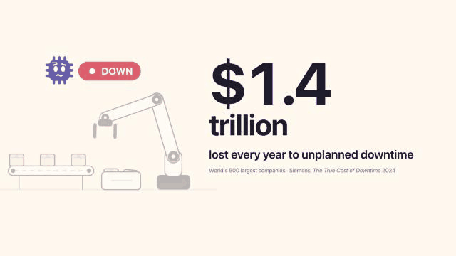
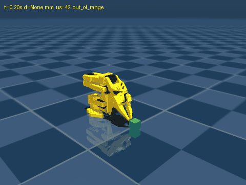
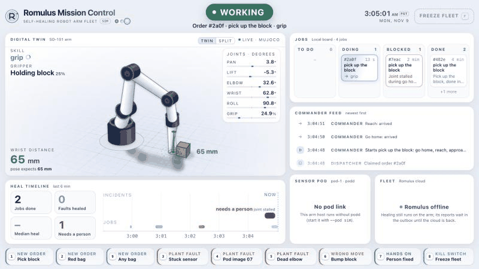
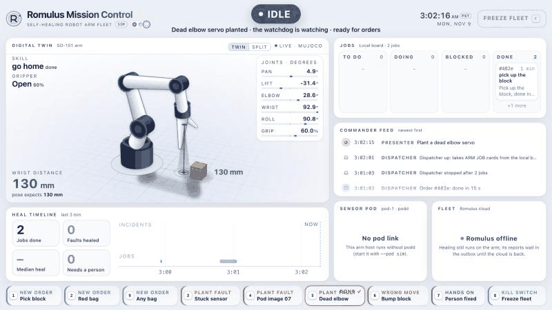
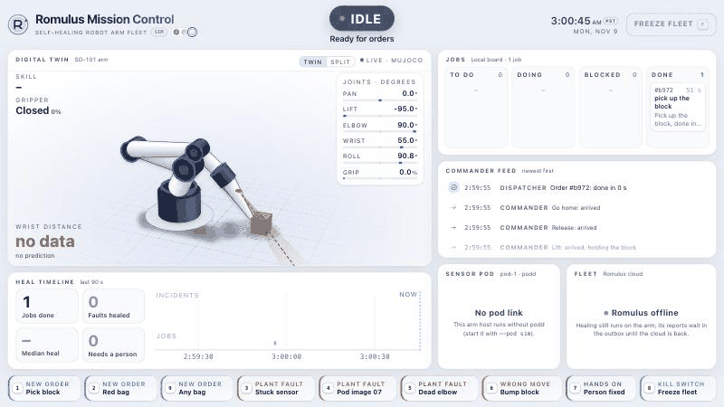
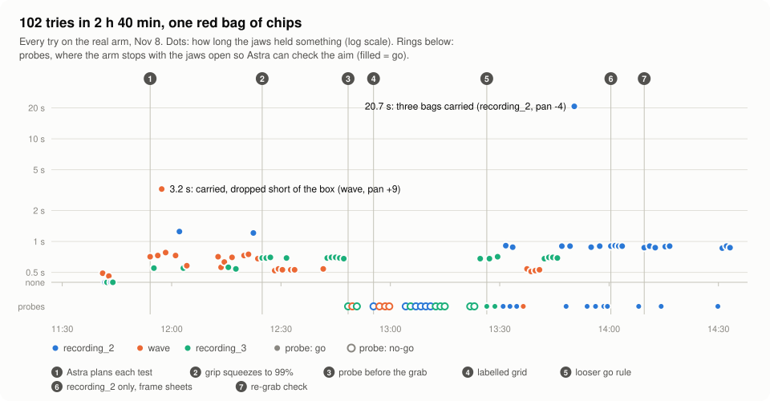
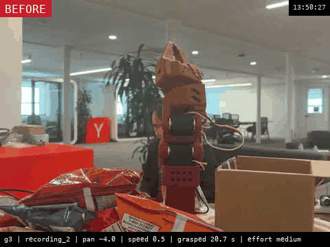
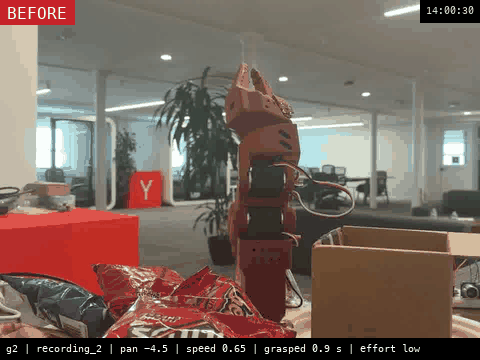

# Naive Nous YC Hackathon

A robotic-arm company that heals itself. When something breaks on a robot (an SO-101 arm on a Raspberry Pi 5, or the STM32 sensor pod next to it), a small healer on the device diagnoses and fixes it, or parks the hardware and asks for a person. The **Romulus** cloud collects every incident, turns fixes that hold into new versions for the whole fleet behind a replay and a canary, and hands hardware faults to Naïve agents as work orders. Built for the Naïve Autonomous Company Hackathon and the Hermes Agent Plugin Hackathon ([`docs/hackathons.md`](docs/hackathons.md)).

Team context, working rules and live status: [`CLAUDE.md`](CLAUDE.md). The whole story: [`docs/project-overview.md`](docs/project-overview.md).

**On this page:** [See it](#see-it) · [How the pieces fit](#how-the-pieces-fit) · [What's where](#whats-where) · [Run it](#run-it)

## See it
**The pitch.** Hardware Buddy: self-healing hardware for robotics and manufacturing. This is Andre's pitch animation ([`pitch/`](pitch/storyboard.md)), the part before the live demo:



**In the simulator, the arm heals itself.** Plain-code checks catch each fault and park the arm, with no model in the loop. Then the arm is healed or handed to a person ([the stories](prototypes/arm-sim/README.md#everything-together-in-one-place), in the MuJoCo twin of the SO-101):

<p>
  
  
  
</p>

- **a:** a bad pod image (left)
- **b:** a stuck sensor (middle)
- **stall:** a dead elbow servo, handed to a person (right)

**Mission Control watches it live** ([`armsim.mission`](prototypes/arm-sim/README.md#everything-together-in-one-place)). Below, two faults are planted from its presenter buttons: the arm heals the first by itself and hands the second to a person.

*A wrong move, healed in 28 s.* The block is bumped 30 mm, so the grip closes on nothing.
1. The arm reverses: jaws open, backed off.
2. The manager answers in 500 ms: relocate, then redo. (Here it's a scripted stand-in; the real one is a Hermes profile.) Plain code approves the plan, since the shift stays inside ±40 mm.
3. The wrist sensor finds the block 30 mm off, and the arm redoes the grip.



*A dead elbow, handed to a person.* The elbow servo dies, and then an order comes in.
1. The watchdog parks the arm.
2. The checked retry at home fails, so the job goes to a person with a work order.
3. Once a person fixes the elbow, the check at home passes.



<details><summary>The same screen when nothing is broken: an order runs itself in 15 s</summary>


</details>

**On the real arm, an LLM ran the experiments.** On Nov 8 an LLM planner, Astra through Hermes, ran 102 pick-and-place tries on the real SO-101, judging each from the bench camera. The red bag never made it into the box. One try lifted three bags for 20.7 s, though, and the charts show why the rest slipped: [the full write-up](prototypes/arm-sim/README.md#the-real-arm-experiment-astra-picks-up-the-red-bag-nov-8).

<picture>
  <source media="(prefers-color-scheme: dark)" srcset="prototypes/arm-sim/media/gentest/timeline-dark.svg">
  
</picture>

<p>
  
  
</p>

- **The 13:50 try (left):** three bags held for 20.7 s.
- **The 14:00 try (right):** frame by frame; the bag slips out at the lift.

## How the pieces fit

```
 on the bench (Pi 5)                                    on the laptop (Docker)           online

 SO-101 arm ── arm healer (Ishaan; device/) ──────────────────────┐
                                                                  │  device API
 STM32 pod ── pod healer (Olir; firmware/healer) ── edge bridge ──┼─ (packages/contracts) ─► Romulus cloud (cloud/) ──► Naïve
                                                 (tools/edge_bridge)                         timeline, gate,         work orders,
 fake arms (tools/fake_device): development, tests, overnight run ┘                          datasets, kill switch   agents
```

- **Every device speaks one contract**, the device API in [`packages/contracts`](packages/contracts/README.md) ([APIs doc](docs/cloud-platform-planning/cloud-platform-apis.md)): check in every 10 s, report each incident with what the healer did, upload evidence, pull assigned versions.
- **The sensor pod gets there through the edge bridge.** Olir's healer records everything locally and never calls the cloud; [`tools/edge_bridge`](tools/edge_bridge/README.md) reads those records on the Pi and reports them, so the healer needs no changes (decision D29). It's tested against the real cloud app, and the arm-sim demo starts it beside Olir's real `podd` ([`demo/up.sh`](prototypes/arm-sim/demo/up.sh)). Nothing in the repo records a run on the bench Pi *(inferred)*.
- **The cloud closes the loop**: fixes that hold become firmware and harness versions, replayed against past incidents and tried on a simulated canary before the fleet gets them ([`cloud/README.md`](cloud/README.md)).
- **The arm-sim prototype runs the whole loop on one laptop** ([`prototypes/arm-sim`](prototypes/arm-sim/README.md)); the sim and Mission Control GIFs above come from it. It has a MuJoCo twin of the SO-101 with its watchdog, a virtual sensor pod read by Olir's real `podd`, Mission Control, a dispatcher that takes orders from a board (a local file or a Naïve card), and a Hermes manager. Its arm reporter checks in with Romulus like any device, and the same code drives the real arm (`--arm real --pod real`).

## What's where

| Folder | What | Owner |
|---|---|---|
| [`cloud/`](cloud/README.md) | Romulus cloud platform: device API, registry, batch job, gate, telemetry and datasets, work orders, timeline | Kent |
| [`packages/contracts/`](packages/contracts/README.md) | `romulus-contracts`: the device ↔ cloud payloads, shared by both sides | Kent |
| [`tools/edge_bridge/`](tools/edge_bridge/README.md) | Runs next to the pod healer on the Pi and reports its incidents, logs and agent actions to the cloud | Kent |
| [`tools/fake_device/`](tools/fake_device/README.md) | N fake arms against the cloud, and the reference device client and outbox | Kent |
| [`firmware/`](firmware/README.md) | STM32 sensor pod: firmware with self-diagnostics, and the pod healer (podd, triage rules, 38 heal tools, [eight known-bad demo images](firmware/demo/bad-images/)) | Olir |
| [`server/`](server/README.md) | Runs the pod healer's model (qwen3.5:4b) on the laptop with Ollama, for the harness on the Pi | Olir |
| [`naive/`](naive/README.md) | The Naïve TypeScript SDK client for Romulus | Olir |
| [`device/`](device/README.md) | The arm healer: the code that runs on the robot (Pi app, supervisor, fake arm and sensor, tests) | Ishaan |
| [`harness/`](harness/) · [`bench/`](bench/README.md) | The healer's agent harnesses h1–h3, and the benchmark that scores them on planted faults ([progress](docs/healer-benchmark-progress.md)) | Ishaan |
| [`arm/`](arm/README.md) | The real SO-101: LeRobot setup and calibration, the taught recordings, and `safe_replay.py` (ultrasonic-gated replay) | Andre, Olir |
| [`prototypes/arm-sim/`](prototypes/arm-sim/README.md) | The SO-101 twin and the whole self-healing loop, in sim and on the real arm: arm host and watchdog, Mission Control, the Hermes plugin, the Nov 8 Astra experiment | James |
| [`prototypes/`](prototypes/) | Also the [fault lab](prototypes/fault-lab/README.md) (can pi and Hermes fix the healer's faults?) and the [Naïve console](prototypes/naive-console/README.md) | James |
| [`hub/`](hub/) | Source of the Arm Company Stack Map artifact | James |
| [`pitch/`](pitch/storyboard.md) | The Hardware Buddy pitch animation: storyboard and the animated pages | Andre |
| [`docs/`](docs/) | Research, the fault catalog, cloud planning, sponsor notes, raw doc dumps | everyone |

## Run it

Needs Docker and [uv](https://docs.astral.sh/uv/).

```bash
uv sync --all-packages
make up && make seed                                    # the cloud on :8000, with arm-1 and sim-1…3
uv run python -m fake_device --n 3 --scenario all       # fake arms through every scripted fault
open http://localhost:8000/                             # incident timeline, fleet, kill switch
make test                                               # every Python test (throwaway Postgres)
```

With the pod on the bench, start podd (`firmware/healer/bin/podd`) on the Pi, then the bridge: `uv run python -m edge_bridge --url http://<laptop-LAN-IP>:8000` ([setup](tools/edge_bridge/README.md#run-it-on-the-pi)).

**The arm in the simulator, with Mission Control** (no hardware, no Docker; this is how the Mission Control GIFs above were made):

```bash
cd prototypes/arm-sim
./setup.sh                                                          # MuJoCo Menagerie's SO-101 model into vendor/
uv venv --python 3.12 .venv && uv pip install --python .venv/bin/python -r requirements.txt
PYTHONPATH=. .venv/bin/python -m armsim poses                       # the sim's taught poses
PYTHONPATH=. .venv/bin/python -m armsim.host --realtime &           # the sim arm, paced to wall-clock time
PYTHONPATH=. .venv/bin/python -m armsim.mission --board file &      # Mission Control on http://localhost:8765
PYTHONPATH=. .venv/bin/python -m armsim.dispatch --board file --exec scripted &   # runs the orders
```

In Mission Control:
- **1** places an order.
- **5** plants a dead elbow.
- **6** bumps the block, so the next grasp misses. The dispatcher heals that only when started with `--manager fake --wrong-action redo`.
- **7** is "a person fixed it".
- **V** switches between the twin and the split view.

More in [`prototypes/arm-sim/README.md`](prototypes/arm-sim/README.md).
