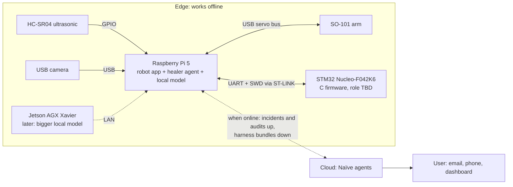

# Project overview: self-healing robots

Everything we know about the project, in one place. This is a living doc, so update it as we learn.

- **Snapshot:** Sat Nov 7 2026.
- **Labels:** every fact cites a source.
  - *(team)*: a decision the team made in conversation on Nov 7.
  - *(inferred)*: our own reasoning.
  - Repo files appear in backticks, and URLs are inline.
- **Companion docs:**
  - [fault-catalog.md](fault-catalog.md): every fault we plan to plant, test or demo.
  - `docs/cloud-platform-planning/`: the cloud PRD and the API outline.
  - [hackathons.md](hackathons.md) and [sponsors.md](sponsors.md): event rules and sponsors.

## TL;DR

- **The problem.** Robots in places without internet can't be reached over SSH. When their software breaks, they stay broken, and the failure data is lost. *(team)*
- **The fix.** A local model and an agent harness on the robot's own computer notice the failure, diagnose it from logs, and write the fix in Python or C firmware. Then they rebuild or reflash, verify, and roll back if the fix fails. *(team)*
- **The cloud.** When the robot gets a connection, Naïve agents in the cloud collect its incidents and send back a better healing harness. There's no model training during the hackathon. *(team)*
- **The demo hardware.** An SO-101 arm, a Raspberry Pi 5, an HC-SR04 ultrasonic sensor, a USB camera, and an STM32 board for C firmware. *(team)*, `firmware` branch
- **The event.** The Naïve Autonomous Company Hackathon. Hacking ends Sun Nov 8 at 11 AM PST, and judges focus on "how much of the company runs without you" (`docs/hackathons.md`).

---

## 1. The problem

- Robots and machines often work where the network is weak or absent: warehouse dead zones, farms, ships, remote sites. *(inferred: examples)*
- When the software crashes or misbehaves there, nobody can SSH in to fix the firmware, and the robot can't diagnose itself. So it stays down, and the data about what went wrong is lost. *(team)*
- Today's robot-ops tools work in the cloud and stop short of fixing anything on the device:
  - Formant F3 *recommends* fixes (https://www.businesswire.com/news/home/20250630008190/en/Formant-F3-Brings-Generative-AI-and-Agentic-Reasoning-to-Robot-Ops).
  - Alloy raised $8M in Aug 2026 to *diagnose* robot-fleet failures (https://theaiinsider.tech/2026/08/13/alloy-robotics-raises-8m-in-new-funding-to-help-engineers-debug-robot-fleets-with-ai-agents/).

  Source: the Romulus notes in `CLAUDE.md`.

## 2. Our bet

- Local models are now good enough to diagnose failures and write the code that fixes them, on the device itself. *(team)*
- The harness around the model matters as much as the model. Prior work (https://github.com/IshaanAyaan/slm-agents) tested this on 200 held-out code-navigation tasks: a 3B model fine-tuned for one narrow role, paired with a harness built for that role, succeeded on 94.5%, against 95.5% for a 72B baseline. The gap was not significant (McNemar p = 0.82), and cost per successful task was 84.8% lower.
- So during the hackathon we improve the *harness*, measured by a benchmark, instead of retraining models. Per-device fine-tuning can come later. *(team)*

## 3. Hackathon context

- **Event:** Naïve Autonomous Company Hackathon, at the YC office in San Francisco. Hacking runs Sat Nov 7, 11:30 AM to Sun Nov 8, 11:00 AM PST. Judging starts at 11 AM, and final presentations are at 1 PM. (`docs/hackathons.md`)
- **Brief:** "Build any company that is primarily run by agents," using the Naïve SDK. The live demo shows what the agents delivered, what they decided, and where people had to step in. (`docs/hackathons.md`)
- **Prizes:** the Main track goes to the company "most likely to scale to millions". First place includes a guaranteed YC interview and $50K+ in sponsor credits. There are also sponsor tracks for Mobilerun, AgentMail and Monid. Nobody has confirmed whether one company can win both Main and a sponsor track. (`docs/hackathons.md`)
- **Credits per hacker:** Naïve $250, Stripe $500 plus the incorporation fee waived, OpenAI $100, Apify $50, Tavily 8K. (`docs/hackathons.md`)
- **The other hackathon:** the team repo also tracks the Hermes Agent Plugin Hackathon (online; entries due Wed Nov 11, 5 PM EST). The team plan has Hermes on the bench, driving the arm through a plugin. (`docs/hackathons.md`, `CLAUDE.md` team status)

## 4. The system at a glance

| Layer | What it is | Status |
|---|---|---|
| 1. Robot | SO-101 arm, with the ultrasonic sensor and the camera | On the bench *(team)* |
| 2. Edge computer | The Pi 5 runs the robot app, the healer agent and the local model. The STM32 runs the C firmware. Later, the Xavier serves a bigger model on the local network | The Pi runs everything for now; the Xavier isn't set up *(team)* |
| 3. Cloud | Naïve agents collect incidents, engineer new harness versions, and run the business side | Planned (`docs/cloud-platform-planning/`) |
| 4. User | Whoever owns and operates the robot | How we talk to them is undecided *(team)* |

Other parts of the team plan, from the team status in `CLAUDE.md`:
- Naïve runs the business and a job board.
- Hermes on the bench drives the arm through a plugin.
- An LLM operates the arm, with RunPod for anything that needs a lot of power or VRAM.
- "Romulus" is the working name for the self-healing and fleet layer.

## 5. Hardware

| Item | Details | Connected to | Source |
|---|---|---|---|
| Raspberry Pi 5 | 8 GB. The main edge computer; runs everything for now | — | *(team)* |
| SO-101 arm | White leader and red follower, 6 Feetech STS3215 servos each. In LeRobot, `robot_type` is `so101_follower` | Pi, through a USB serial servo-bus adapter | `CLAUDE.md` team status |
| HC-SR04 ultrasonic | Runs on 5V; range 2–400 cm; trigger and echo pins. ECHO needs a voltage divider down to 3.3V (gpiozero suggests 330 Ω / 470 Ω) | Pi GPIO | *(team)*; https://cdn.sparkfun.com/datasheets/Sensors/Proximity/HCSR04.pdf; https://gpiozero.readthedocs.io/en/stable/api_input.html |
| USB camera module | HBV-W20217 V22, HD 720p, 72° lens. Check its formats with `v4l2-ctl --list-formats-ext` | Pi USB | *(team)* |
| STM32 Nucleo-F042K6 | STM32F042K6: Cortex-M0, 32 KB flash, 6 KB RAM. The on-board ST-LINK gives SWD flashing and a virtual COM port (USART2, 115200 8N1). The LED is on PB3 | USB (the ST-LINK) | `firmware/stm32f042k6-hello/` on the `firmware` branch |
| Jetson AGX Xavier | 64 GB, Volta GPU (sm_72), JetPack 5.x era. Planned as a bigger local model server. Not set up | Local network (planned) | *(team)*; §13 |
| Dev laptop | MacBook Air M5, 24 GB | — | *(team)* |

**Power and venue**
- **Pi 5 supply:** without a 5V/5A supply the Pi 5 caps USB current, and under-voltage shows in `vcgencmd get_throttled` (https://www.raspberrypi.com/documentation/computers/os.html; https://docs.waveshare.com/UPS-HAT-E-Tutorials-Raspberry-Pi).
- **Servo supply:** it must match the servo variant. A 12V supply on 7.4V servos causes "Input voltage error" (https://github.com/TheRobotStudio/SO-ARM100/issues/174).
- **Venue Wi-Fi:** it ruins robot demos, so bring a router, an Ethernet cable and a recorded backup (https://generalrobots.substack.com/p/nailing-the-demo, via the Romulus notes in `CLAUDE.md`).

## 6. Software stack

- **OS on the Pi:** Raspberry Pi OS. The exact version is still to be checked.
- **Robot control: LeRobot v0.7.0**, released Nov 5 2026 (https://github.com/huggingface/lerobot/releases/tag/v0.7.0). What changed:
  - Feetech servos now go through a rustypot-backed `SerialMotorsBus`.
  - `OperatingMode`/`TorqueMode` gave way to `bus.set_operating_mode(...)`, and `scan_port` and `broadcast_ping` were removed.
  - The Linux torch builds are CUDA 13, which needs NVIDIA driver 580+.

  Pin this version, since it has breaking changes (Romulus notes).
- **Simulation:** MuJoCo Menagerie ships an SO-101 model, `robotstudio_so101`, that runs on macOS (https://github.com/google-deepmind/mujoco_menagerie). MuJoCo 4.0.0 shipped Nov 6 (Romulus notes).
- **Ultrasonic:** gpiozero with the `lgpio` pin factory. RPi.GPIO doesn't work on the Pi 5 (https://gpiozero.readthedocs.io/en/stable/api_pins.html; https://bugs.launchpad.net/raspbian/+bug/2058658).
- **Camera:** OpenCV, through LeRobot's `OpenCVCamera`. It accepts a device index, a device path, or a video file (`src/lerobot/cameras/opencv/configuration_opencv.py` on GitHub).
- **Firmware** (`firmware` branch):
  - Bare-metal C on the CMSIS register headers, with no HAL.
  - `make` builds it, OpenOCD flashes it (target `stm32f0x.cfg`), and `make check` uses `fwtool` to read the build ID and uptime back over SWD.
  - The shared build rules (`toolkit/mk/stm32.mk`) and `fwtool` aren't on the branch yet.
- **Healer:** a local model server (llama.cpp's `llama-server`, which speaks the OpenAI API) plus an agent harness, chosen by benchmark (§8.5, §13).
- **Cloud:** the Naïve SDK, plus the sponsors' services (AgentMail, Mobilerun) and possibly RunPod (§9).

## 7. What the robot does, and the demo story

- **Still being designed:** what the arm does in the demo. *(team)*
- **The principle:** the sensor output drives the robot, and sensor failures are among the faults the healer must fix. *(team)*
- **Iteration 1, Python on the Pi:**
  - The arm is hardcoded to hold an object, and drops it when something comes close to the ultrasonic sensor. That rule is the planted bad code, and the healer should find it and remove it.
  - Physical triggers: a hand very close to the sensor, or tapping the arm so it freezes with an error.

  *(team)* In the fault catalog these are D1–D3.
- **Iteration 2, C firmware on the STM32:** a bug in the C code makes the arm move wrong, for example sin instead of cos, or a casting error. The healer fixes the C code and reflashes the firmware. *(team)* In the fault catalog these are F1–F11.
- **Hero demo idea from the Romulus notes:**
  1. A judge covers the camera, or a bad policy is pushed.
  2. The bench detects it and goes to a safe pose or rolls back.
  3. An agent writes the root cause, and AgentMail sends the incident report.
  4. If the fault is hardware, Mobilerun phones in a parts order.

  (`CLAUDE.md`)
- **Evidence for the judges:**
  - A benchmark chart: harness v0 against v1, then the v2 the cloud ships. *(inferred)*
  - A morning count of agent actions against human ones, after the company loop runs overnight unattended. (Romulus notes)

## 8. The edge healer

### 8.1 The healing loop
1. **Detect** a problem with the health checks (§8.2).
2. **Snapshot** the code, the config and the firmware build, so the fix can be undone. *(team)*
3. **Park** the arm in a safe pose with torque off. *(team)*
4. **Collect evidence:** log tails, telemetry, a stack dump of a stuck process (`py-spy dump`), the serial log, and the audit (§8.3). *(inferred)*
5. **Diagnose and write the fix:** the agent plus the local model. It may touch anything on the device. *(team)*
6. **Apply:** restart the app, or rebuild and reflash the firmware. *(team)*
7. **Verify:** health checks and the audit. If they fail, roll back to the snapshot automatically. *(team)*
8. **Record** the incident (what broke, the evidence, the fix, the result) in a local outbox that waits for the cloud. *(inferred)*

Long heals are fine, because the robot is parked and the process is autonomous. *(team)* The LLM is never part of the real-time control or safety loop; it acts only while the arm is parked (Romulus design rule; *(team)*).

### 8.2 Health tiers *(team)*

| Tier | Catches | Signals *(inferred)* |
|---|---|---|
| 1 | Crashes and errors | Non-zero exit code, a traceback, `E code=…` lines, a failed build or flash |
| 2 | Stuck loops and hangs | Heartbeat age (the firmware already prints `alive: uptime …` every second), loop period, stale camera frames, watchdog resets (`reset : iwdg`), `py-spy dump` |
| 3 | Wrong behavior (a full, intelligent assessment; later, on the device or in the cloud) | Values outside their physical range, behavior that breaks `SPEC.md`, black or frozen frames, `get_throttled` nonzero, temperatures |

Cheap camera checks: brightness and frame-to-frame difference on a small grayscale copy; frame age measured against the fps. LeRobot's `read_latest(max_age_ms)` raises `TimeoutError` (LeRobot `camera_opencv.py` on main).

### 8.3 The full audit (proposed) *(inferred)*

One command writes one JSON file containing:
- versions: OS, Python, LeRobot, and the firmware build ID
- devices: by-id serial paths, camera formats, the GPIO chip
- the calibration file's hash
- disk, memory, temperature and throttle bits
- whether the model server is healthy
- the last few incidents

It has three jobs: the known-good baseline, the before-and-after check for every heal, and the thing that gets uploaded to the cloud.

### 8.4 The healing harness
- **What it is:** everything around the model that decides how it heals: instructions, tools, playbooks, checks and policy. The cloud engineers new versions and sends them to the device. No model is retrained. *(team)*
- **Proposed layout:** a versioned folder, shipped as one bundle. *(inferred)*
  - `prompt.md`: the rules. Snapshot first, park before touching the arm, verify after, never raise torque or speed limits, and park and report on hardware faults.
  - `playbooks/`: one per fault family (serial, camera, GPIO, Python environment, firmware build and flash, disk and memory). The cloud adds new ones from fleet incidents.
  - `tools/`: collect logs, audit, park, stack dump, list devices, build and flash firmware, restore calibration, roll back.
  - `checks/`: the tier 1–3 health checks.
  - `policy.yaml`: per-user settings for which fixes run automatically and which need approval, plus limits and the notification channel.
  - `VERSION`, plus a changelog.

### 8.5 Agent harness candidates
Pick by running both on the benchmark. *(team: "make the harness better for it, write benchmarks")*
- **pi** (`earendil-works/pi`, formerly `badlogic/pi-mono`): a TypeScript coding agent. It has print, JSON and RPC modes for automation, plus an SDK, extensions and skills (README: https://github.com/badlogic/pi-mono). The README says it needs Node 22.19+, which we haven't confirmed on the Pi.
- **mini-swe-agent** (https://github.com/SWE-agent/mini-swe-agent):
  - A loop of about 100 lines whose only tool is bash, so there's no tool-call format for a small model to get wrong.
  - The prompts live in YAML, and it runs local models through litellm (`docs/models/local_models.md`).
  - For unknown models, set `cost_tracking: ignore_errors`.

### 8.6 Guardrails
- Snapshot before every fix, and roll back automatically if the checks fail. *(team)*
- The arm stays parked with torque off while healing. *(team)*
- The healer may touch anything on the device; there are no permission limits for now. *(team)*
- The LLM never sits in the real-time control or safety loop. (Romulus notes)
- Each kind of action earns autonomy (suggest, then approve, then automatic) and loses it after a bad fix. (Romulus notes)
- Hardware faults get parked and reported, and code stays untouched. *(inferred)*
- Constrained output: llama-server can force JSON that matches a schema, or a grammar (https://github.com/ggml-org/llama.cpp/blob/master/grammars/README.md). *(inferred: useful for small models)*

## 9. The cloud layer

### 9.1 What it does (PRD, `docs/cloud-platform-planning/cloud-platform-prd.md`)
- **Objective:** a general-purpose platform for managing the software and operations of robotic systems.
- **User stories** (for whoever manages the robot systems):
  - custom self-healing software embedded on the edge devices
  - continuous updates learned from comparable deployed systems
  - a dashboard for operating the robots, including ordering parts and dispatching technicians
  - *(tentative)* systems that talk to each other: digital twins, ERP, other services
- **Requirements:**
  1. CI/CD that deploys the firmware and the self-healing agent: a device-side layer that pulls and validates updates, plus cloud endpoints that serve each version.
  2. Firmware that pushes logs and environment data to the cloud for batch analysis.
  3. Cloud batch analysis that produces new versions of the firmware and the self-healing harness (and model).
  4. Phone calls through the Mobilerun agent to order parts or book appointments.

### 9.2 API outline (`docs/cloud-platform-planning/cloud-platform-apis.md`)
- **CI/CD:** create, read, update and delete firmware; the same for the self-healing harness (the "embedded SRE").
- **Harness updates:** push logs from the edge to the cloud, and run batch jobs that update the harness.

### 9.3 Fleet ideas (Romulus notes in `CLAUDE.md`)
- **Positioning:** what an arm company sells is uptime.
- **One loop at three scales:**
  - Arm: detect, diagnose, act, verify, learn.
  - Fleet: canary rollout and automatic rollback.
  - Company: every verified heal is also a billing event, an incident email and a training example *(inferred in the notes)*.
- **Pitch:** "PagerDuty with hands" *(inferred in the notes)*.
- **Cloud diagnosis:** the cloud LLM isn't in the control loop, so serverless RunPod is probably fine. The model should read images, because camera frames are the best evidence *(inferred in the notes)*.
- **Checking task success from video:** Robometer-4B in LeRobot, which needs a GPU (https://github.com/huggingface/lerobot/blob/main/docs/source/robometer.mdx).
- **Market context:** AI incident response for software has reached $1B valuations twice, at Resolve (https://techcrunch.com/2026/02/04/ai-sre-resolve-ai-confirms-125m-raise-unicorn-valuation/) and Traversal (https://dealroom.co/news/169321-traversal-raises-120m-at-1b-valuation-to-automate-incident-response/).

### 9.4 Naïve SDK facts that shape the design
- **Hosted:** agents and their Computers run in Naïve's cloud, not on the robot. *(inferred from the docs below)*
- **Computer:** a disposable Linux micro-VM with a shell, 1–16 vCPU, up to 64 GiB RAM and 100 GiB of disk. No GPU is documented. (https://usenaive.ai/docs/capabilities/computer.md)
- **Network:** "general outbound network access", and "Inbound access is opt-in and governed". The private ranges 10/8 and 172.16/12 are unreachable; 192.168/16 is "not reliably blocked". (https://usenaive.ai/docs/computer/networking.md)
- **What wakes an agent:** email or SMS to its inbox. Crons (deployments) run at most every 5 minutes, each with its own budget. Signed `on_idle` webhooks go out. We found no inbound webhook that wakes an agent. (https://usenaive.ai/docs/capabilities/deployments.md; https://usenaive.ai/docs/capabilities/identity.md)
- **Tools:** each is set to allow, ask or deny. MCP servers need a public HTTPS URL, each agent can have at most 20, and their tools default to ask. (`docs/sponsors.md`; https://usenaive.ai/docs/capabilities/tools)
- **Files:** org-wide storage, up to 5 GiB per file. (https://usenaive.ai/docs/capabilities/files.md)
- **Budgets:** every agent needs one, and the roster holds at most 20 agents. (Naïve vetta README on npm: https://www.npmjs.com/package/@usenaive-sdk/vetta)

## 10. The device–cloud link (proposed, not confirmed)

- **Known:** the device is mostly offline and sometimes connects. The cloud must be able to send it updates. The team still has to define the contract. *(team)*
- **Default proposal:** while it's online, the device calls the cloud. It uploads its incident bundles and latest audit, then downloads any harness bundle waiting for it. To the user, that looks like a push. *(team: proposed, not confirmed)*
- **Why the device pulls:** Naïve sandboxes have no general way in to a device (§9.4), and devices usually sit behind NAT. *(inferred)*
- **Details** *(inferred)*:
  - An offline outbox in SQLite, with idempotent uploads.
  - Signed, versioned bundles: check the hash, swap atomically, and keep the previous version for rollback.
  - Viam uses the same capture-then-sync pattern (https://docs.viam.com/data-ai/capture-data/advanced/how-sync-works).
- **Endpoint sketch** *(inferred)*: `POST /devices/{id}/incidents`, `POST /devices/{id}/audits`, `GET /devices/{id}/harness?have=<version>`.

## 11. The user

- **Who:** the person who owns or operates the robots ("manager of robot systems" in the PRD).
- **How we reach them:** undecided. *(team)*
- **Options:**
  - Incident emails through AgentMail.
  - Phone calls through Mobilerun to order parts or book technicians (PRD).
  - A dashboard for approvals and a fleet view (PRD).

  Sponsor setup details are in `docs/sponsors.md`.
- **Per-user settings:** each user has their own policy: which fixes run automatically, which need approval, limits, and how to notify them. *(team: "agent per user")*

## 12. Testing and the benchmark

- **Plan:** find real faults, build agents that run on a Mac, test them, improve the harness, add health checks and the full audit, then move to the hardware. *(team)*
- **Stages:**
  1. Everything on a Mac, with mocks.
  2. The agent on a Mac, fixing the real Pi over SSH.
  3. Everything on the Pi. *(team: testing with just the Pi now)*
  4. The Xavier as the model server.

  Stages 1 and 2 are *(inferred)*.
- **Task format:** every fault is a task with `inject`, `verify` and `oracle` scripts. The rules are in `docs/fault-catalog.md`, and the shape is modeled on AIOpsLab (https://github.com/microsoft/AIOpsLab) and Terminal-Bench (https://github.com/harbor-framework/terminal-bench). *(inferred)*
- **Scoring:** healed on the first try, time to heal, steps and tokens, regressions, and correct restraint on hardware faults. *(inferred)*
- **Mac test bed parts:**
  - Confirmed on GitHub:
    - LeRobot's `MockBus` (`tests/mocks/mock_motors_bus.py`), whose `absent` set makes chosen servo IDs never answer.
    - `OpenCVCamera` reading a video file.
  - From the docs: gpiozero's `MockFactory` (https://gpiozero.readthedocs.io/en/stable/api_pins.html).
  - *(inferred)*:
    - host-gcc builds of the firmware's control logic
    - a fake `vcgencmd`
    - one small supervisor that restarts the app on a crash, watches the heartbeat and triggers the healer, and runs the same on a Mac and the Pi

## 13. Running models on each device

- **Pi 5 (8 GB, CPU only)**, with llama.cpp:
  - Reported speeds: Qwen2.5 1.5B about 10–12 tok/s, Gemma 3 1B 11.5, Llama 3.2 1B 11.2 (https://stratospherelinuxips.readthedocs.io/en/develop/immune/research_rpi_llm_performance.html). A 0.5B model runs at about 15–28 tok/s (https://simeononsecurity.com/articles/ai-models-raspberry-pi-4-5/).
  - Coding models of 3–4B will be slower *(inferred)*, which is fine because long heals are acceptable *(team)*.
  - The Pi needs active cooling under load (same sources).
- **Jetson AGX Xavier (JetPack 5.x, CUDA 11.4):**
  - **Builds:** llama.cpp needs a build for `sm_72`. A known build error (`__fp16` undefined, https://github.com/ggml-org/llama.cpp/issues/10555) was fixed by PR #10616, and the same issue reports a CMake build that hangs at "loading model".
  - **Containers and Ollama:** the dusty-nv r35 containers (https://hub.docker.com/r/dustynv/llama_cpp) date from 2023. Stock Ollama has had GPU-detection problems on JetPack 5 (https://github.com/ollama/ollama/issues/2408).
  - **Reported speeds (anecdotal):** gpt-oss-20b Q4_K_M at 12.9 tok/s (https://forums.developer.nvidia.com/t/llm-inference-results/347999), and qwen3-coder:30b at about 18.9 tok/s (https://glama.ai/mcp/servers/dangraf/jetson-llm-mcp/tree).
  - **LeRobot stays on the Pi:** its CUDA 13 torch builds need driver 580+, which JetPack 5 doesn't have. *(inferred from the release notes)*
- **Dev Mac (M5, 24 GB):** gpt-oss-20b runs in 16 GB (https://huggingface.co/openai/gpt-oss-20b). Qwen3-Coder-30B-A3B at Q4 is about 18 GB and may exceed the GPU memory macOS allows by default. *(inferred)*
- **Model facts (vendor-reported):**
  - Qwen3-Coder-30B-A3B: 30.5B parameters in total, 3.3B active (https://huggingface.co/Qwen/Qwen3-Coder-30B-A3B-Instruct).
  - gpt-oss-20b: 21B in total, 3.6B active; SWE-bench Verified 53.2.
  - Devstral Small 2507: 24B; SWE-bench Verified 53.6% (https://huggingface.co/mistralai/Devstral-Small-2507).

## 14. Prior art and positioning

| Who | What | How we differ *(inferred)* |
|---|---|---|
| Formant F3 | Agentic robot ops; root-cause analysis; recommends whether a human or the system should fix it (https://www.businesswire.com/news/home/20250630008190/en/Formant-F3-Brings-Generative-AI-and-Agentic-Reasoning-to-Robot-Ops) | Cloud-based and recommends; we fix on the device, offline |
| Alloy Robotics | $8M to debug robot fleets with AI agents (link in §1) | Diagnoses; we close the loop |
| Viam | Fleet management, OTA config, ML at the edge, offline data capture and sync (https://viam.com/solutions/fleet-management) | No self-healing diagnosis loop |
| fixpi | An LLM agent that SSHes into a Linux device, reads logs and proposes repairs, using a cloud LLM (https://pypi.org/project/fixpi/) | Needs a network and a cloud model |
| NASA JPL ROSA | A natural-language agent for ROS robots (https://github.com/nasa-jpl/rosa) | An operator's assistant, not an autonomous healer |
| Foxglove, Edge Impulse, balena | Observability, edge ML, OTA fleet updates | No diagnosis model |
| Resolve, Traversal | AI incident response for software, each valued at $1B+ (links in §9.3) | Software only; we do hardware, offline |

Positioning *(inferred)*: existing tools either need a cloud connection to a big model, or have no diagnosis model at all. We put a small model on the device that diagnoses and fixes problems offline, while cloud agents improve its harness across the fleet.

## 15. Research foundations

- **NeSy-Edge** (Mar 2026): self-healing at the edge, from logs to a causal graph to a root cause, but a cloud LLM does the final diagnosis (https://arxiv.org/abs/2603.21145).
- **Syn-Diag** (Oct 2025): a cloud teacher model distilled into a 1B edge model with LoRA for fault diagnosis. It classifies faults and doesn't choose actions (https://arxiv.org/abs/2510.05733).
- **REFLECT** (CoRL 2023): explains robot failures from summarized sensor data. Feeding raw sensor text straight to the LLM did poorly (https://arxiv.org/abs/2306.15724).
- **AHA** (ICLR 2025): builds failure data by perturbing successful demonstrations (https://arxiv.org/abs/2410.00371).
- **AIOpsLab** (MLSys 2025): an SRE-agent benchmark built on fault injection, scoring detection, localization, root cause and mitigation separately (https://arxiv.org/abs/2501.06706).
- **LLM4PLC** (ICSE-SEIP 2024): an LLM proposes and deterministic verifiers check, which raised the valid-program rate from 47% to 72% (https://arxiv.org/abs/2401.05443).
- **TinyAgent** (2024): a 1.1B model fine-tuned for on-device function calling (https://arxiv.org/abs/2409.00608).
- **Autonomic computing and LLMs:** https://arxiv.org/abs/2407.14402 and https://arxiv.org/abs/2401.07534.

**Gaps we can claim** *(inferred from the above)*:
- Detecting, fixing and verifying fully on the device.
- An automated cloud pipeline that improves each device's harness.
- Safety-bounded evaluation on real hardware: whitelist compliance, unsafe-action rate, and time to heal on a Pi.

## 16. Risks

- **Model quality:** small models on a Pi CPU may not write correct fixes. Measure early on the benchmark. *(inferred)*
- **The Xavier:** its old software (JetPack 5, CUDA 11.4) makes the model server slow to stand up (§13).
- **LeRobot v0.7.0:** two days old, with breaking changes, so pin it (§6).
- **Venue Wi-Fi** (§5).
- **Power:** the Pi 5's supply and the servo supply voltage (§5).
- **Safety:** the arm must stay parked while code changes, and rollback must work before any live demo. *(inferred)*
- **Physical triggers vary** (a hand, a tap), so keep scripted injections as a backup. *(inferred)*

## 17. Open questions

1. What does the STM32 do in the loop, and how does it talk to the Pi (UART over the ST-LINK port at 115200)?
2. What does the arm do in the demo? (being designed)
3. Which agent harness and which model run on the Pi 5? (being tested)
4. What exactly is the device–cloud contract? (§10)
5. Who is the user, and how do they hear from us? (§11)
6. When does the Xavier come online, and does it host the model?
7. **For Naïve:** is there any inbound trigger besides email or SMS? Do Computers get GPUs? Can files get public URLs?
8. **For the organizers:** can one company win both Main and a sponsor track?
9. Which model runs the cloud diagnosis on RunPod? (team status)
10. Do the AgentMail and Monid MCP servers accept a bearer token? (team status)
11. Which Raspberry Pi OS version is on the Pi, and which formats does the camera support?

## 18. Glossary

| Term | Meaning |
|---|---|
| Healer | The agent and local model on the edge computer that detect, diagnose, fix and verify |
| Harness | Everything around the model: prompt, tools, playbooks, checks, policy. Versioned and improved by the cloud |
| Playbook | Instructions for one family of faults |
| Tier 1 / 2 / 3 | Crash or error / hang or stuck loop / wrong behavior |
| Park | Move the arm to a safe pose and turn torque off |
| Incident | The record of one failure: evidence, fix, result |
| Audit | The JSON snapshot of the device's state (§8.3) |
| inject / verify / oracle | A benchmark task's scripts: plant the fault / check health / apply the known fix |
| Leader / follower | On the SO-101, the hand-moved arm and the arm that copies it |
| SWD, ST-LINK | The debug interface used to flash the STM32, and the on-board probe that drives it |
| VCP | The virtual COM port: the board's UART as it appears over USB (`/dev/ttyACM*`) |
| IWDG | The STM32's independent watchdog: it resets the chip if the firmware stops responding |
| HardFault | The Cortex-M fault exception, for example on an unaligned access on the M0 |
| Naïve Computer | A Linux sandbox VM that a Naïve agent works in |
| Romulus | The working name for the self-healing and fleet layer |

## 19. Sources

- **Repo:**
  - `CLAUDE.md` (team status and the Romulus notes)
  - `docs/hackathons.md`, `docs/sponsors.md`, `docs/cloud-platform-planning/`
  - the `firmware` branch (`firmware/stm32f042k6-hello/`)
  - `docs/fault-catalog.md`
- **External:** the URLs inline above. The Nov 7 research reports behind §13–15 were read online only; their numbers are labeled as reported or anecdotal.
