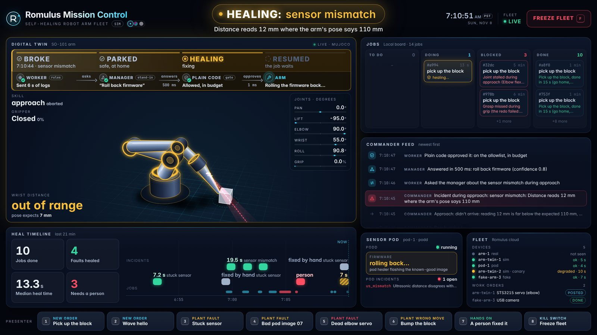
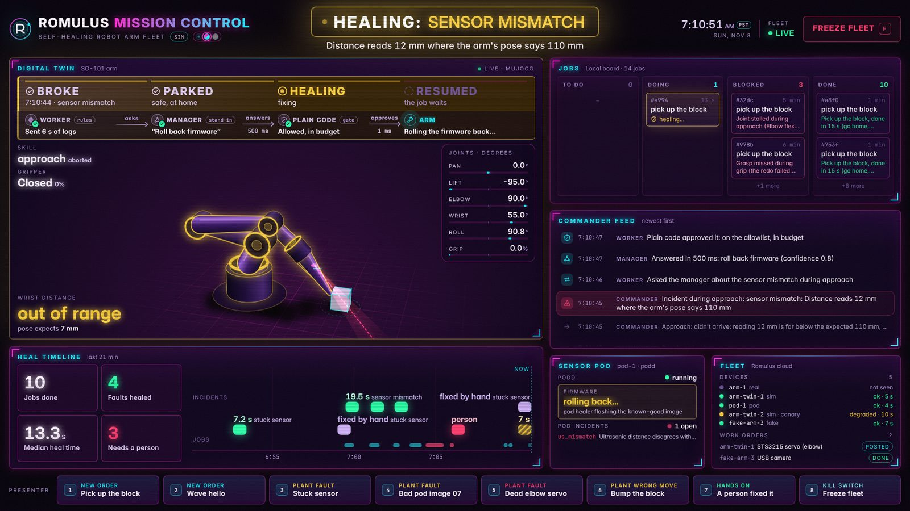
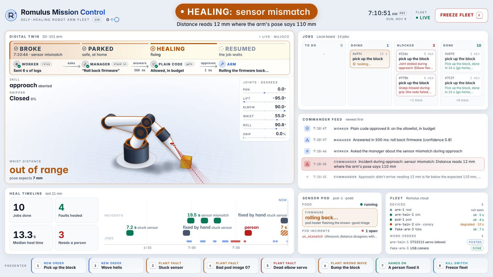
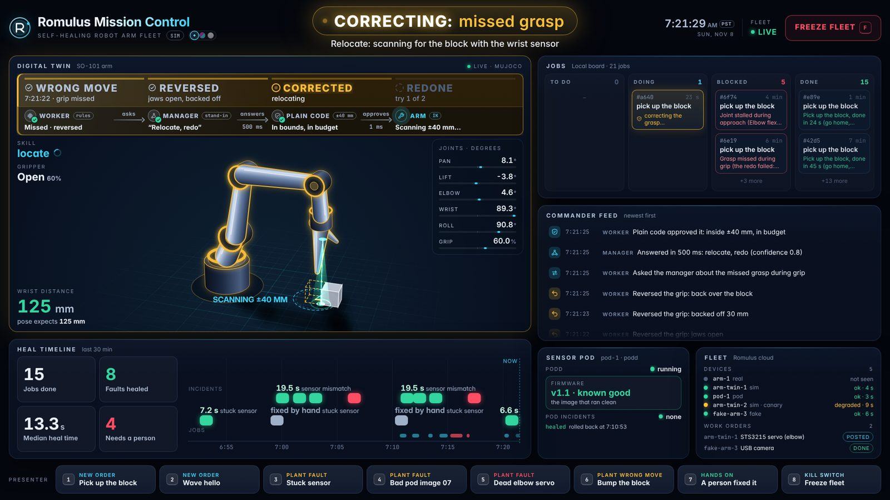
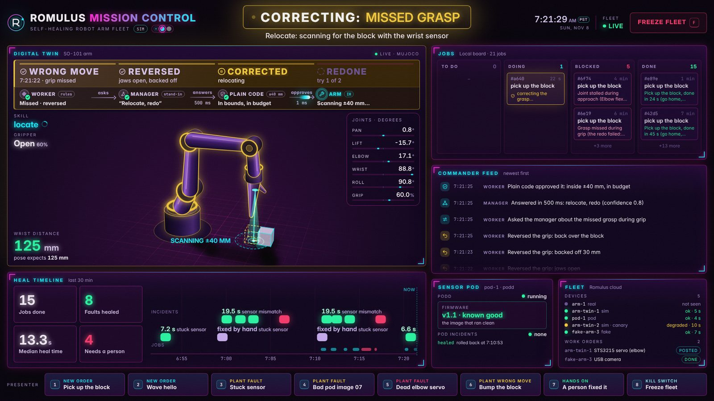
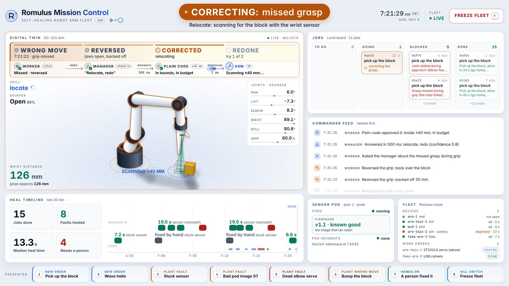

# Morning brief (James): the prototype, everything together

_Updated Sun Nov 8, about 7:40 AM PST. The 1:55 AM brief is kept below, from "What works"._
- **Branch:** run `main` (`git pull origin main`). `james/arm-sim-ydcsss` is the cloud session's working branch; its review fixes merge into `main` once checked.
- **On the real arm today:** start with [`HANDOFF-LOCAL.md`](HANDOFF-LOCAL.md) (which code to run, where each piece runs, the bench steps, what not to edit).
- **Stack Map:** https://claude.ai/artifact/7TriXR2KDUm9GxLg3o3aZ2. Its plan checklist (`hub/src/content/proposal.ts`) now marks items 8, Soak, 9, UI, WM, C2 and WB done; rebuild with `npm run build` in `hub/` to republish it.
- **Tests:** 112 pass across the 8 files in `tests/` (each runs as `PYTHONPATH=. .venv/bin/python tests/test_<name>.py`).

## Built overnight (2–7:30 AM), all in sim
| What | Run it (from `prototypes/arm-sim`, with `PYTHONPATH=. .venv/bin/python -m`) | Status |
|---|---|---|
| **Autonomous loop (item 8):** an order becomes an `ARM JOB` card, the dispatcher claims it, Hermes (or the scripted commander) does it, a fault heals, the card closes | `armsim.orders add pick --board naive`, then `armsim.dispatch --board naive --exec hermes` | Sim soak: 6 of 6 done, no double claims. Review fixes in: SIGINT to Hermes first, only cards with an order id, one dispatcher per arm (lock next to the socket, claim token), unknown status never treated as "not done" |
| **Soak (every 10 min, half with a planted fault)** | `armsim.soak run --board naive --with-dispatcher hermes --every 600 --hours 4` (see `SOAK.md`) | Ready; not started on your Mac |
| **Mission Control (item 9)** | `armsim.mission --board naive`, then open `http://localhost:8765/?look=mission` | Done; 8 presenter buttons (hotkeys 1–8) |
| **Worker → manager healer** | `armsim.dispatch --board naive --exec scripted --manager hermes --manager-url http://127.0.0.1:8642/p/manager` (or `--manager fake` without Hermes). `--manager` works with the scripted commander only; with `--exec hermes`, Hermes heals by its own rules. `hermes-manager/README.md` sets up the manager profile | Built and tested with a fake manager; **not run against a real Hermes yet** |
| **Category 2, a wrong action** | `armsim.stories redo --manager fake` (sim only) | Missed grasp → reverse → the manager corrects the approach (±40 mm) → redone, or a person after two misses |
| **Worker-model benchmark** | `workerbench/RESULTS.md` | Ran on a Runpod L40S, about $2.13. Pick: `lfm3:1.7b` as the laptop worker, `qwen3.5:4b` as the fallback. No model may open incidents alone |
| **Healer level 2 and 3** | `docs/healer-data-levels.md`, `armsim.level3 train` | L2 ChatTS ran (~$0.11); L3a classifier: 0 of 74 healthy flagged on a fresh batch |

**Runpod:** about $2.24 spent in total tonight (L2 $0.11, the benchmark $2.13), out of your $10. Every pod is terminated (`GET /v1/pods` returned `[]` at 7:29 AM).

## Pick a look for Mission Control
Three looks, same screen. Switch with `?look=mission|neon|light`, the dots next to the title, or the L key; the choice is remembered in the browser. Screenshots (healing, then a wrong move being corrected):

| mission (dark) | neon | light |
|---|---|---|
|  |  |  |
|  |  |  |

All 88 shots (every state, at 1920 and 1280) are in `runs/media/r2-<look>-<state>.png` in the cloud session only; `runs/` is gitignored. *(inferred: on a projector, `light` reads best in a bright room and `mission` in a dark one; nobody has checked colours on a projector yet.)*

**Presenter keys:** 1 order pick · 2 order wave · 3 stuck sensor · 4 bad pod image 07 · 5 dead elbow · 6 bump the block (wrong move) · 7 a person fixed it · 8 freeze fleet. Also C (clear), F (freeze), L (look), W (wrong move). When Mission Control listens beyond localhost (`--host 0.0.0.0`), the buttons need `--token` and the page opened with `?token=`.

## Your steps this morning (on the Mac)
1. **Pull:** `git pull origin main`.
2. **Revert Hermes's compaction test setting:** `hermes config set compression.threshold_tokens null`.
3. **Manager profile (about 20 min):** follow `hermes-manager/README.md` (`./setup.sh a 127.0.0.1`, which applies `config.manager.yaml`; then `./check.sh`, which applies the worker's own toolset rule and names anything it won't accept; then one `./ask.sh samples/esc-us_frozen.json`). The worker only asks a manager whose `/v1/toolsets` shows delegation on and nothing but memory and skills beside it. The model is ChatGPT 6 sol at default reasoning, through your ChatGPT login.
4. **The loop with the real manager:** `armsim.dispatch --board naive --exec scripted --manager hermes --manager-url http://127.0.0.1:8642/p/manager --wrong-action redo` (drop `/p/manager` if you took setup branch b), and Mission Control beside it. For the Hermes-commander demo instead, run `--exec hermes` without `--manager`.
5. **Optional worker model:** `ollama pull lfm3:1.7b`, then add `--worker-lm ollama --worker-model lfm3:1.7b` to the dispatcher.

## Known gaps
- Wrong moves are not host incidents while the redo runs, so they don't show on the heal timeline or in "Faults healed". One the redo gives up on becomes a host incident handed to a person (`grasp_missed`), so the next order waits until "a person fixed it" (key 7).
- The manager's "Unreachable" wording on Mission Control has never been on screen; it was only matched from the dispatcher's error text.
- The worker model is off by default: plain code builds the escalation packet, and with `--worker-lm ollama` the model adds its own answer (kind, evidence, message) to it. Plain code still checks the manager's plan.
- Level 3 is not in the loop yet (L3b).

## What works (simulation, on your Mac)
**One command per story**, after `prototypes/arm-sim/demo/up.sh`. Run them with `PYTHONPATH=. .venv/bin/python -m armsim.stories …` from `prototypes/arm-sim`:

| Story | Result |
|---|---|
| `a` (bad pod image 07, the bench's fault) | the approach sees "reads 12 mm where the pose says 110 mm" and parks; Olir's `podd` flags `us_mismatch`; rollback (a stand-in in sim) and the check at home take 20 s; the arm resumes and picks |
| `b` (stuck sensor mid-job) | "Distance stuck at 130 mm while the arm moved 29 mm", then a restart through `podd`, then the pick. 33 s |
| `b --hermes` | a Naïve card drives Hermes. Done once tonight on card `crd_m27qc…`: Hermes healed the sensor, finished the job, commented `RESULT:`, and the card went to done |
| `stall` | a dead elbow servo fails the checked retry and is handed to a person; Romulus opens a `needs_human` work order |

**Final regression (about 2 AM, on the pushed code):**
- **Stories:** `a` (image 07 and image 02), `b` and `stall` all pass.
- **Fault factory, 1,000 runs:** none of 142 healthy runs flagged, and all 115 dead servos caught. The other planted faults are caught in 23–54% of runs. The rest look fine to level 1, which is the gap level 3 is for.

**Also working:**
- **Romulus on your Mac** (`localhost:8000`) gets `arm-twin-1`'s incidents and `pod-1`'s (through Kent's edge bridge), with the right outcomes and recordings.
- **Backup-video clips** are in `prototypes/arm-sim/runs/media/` (`story-a/b/stall.mp4`, about 0.2–0.3 MB each). Story A there is the image-02 version.
- **The real-arm adapter** (`armsim/real.py`, on Andre's `prims.Arm`) passes its 5 mock tests.

## Overnight on main: Olir's #54 passed on the real bench (12:05 AM)
1. Bad pod release v1.7 (image 07) makes the arm flail.
2. Olir's pod healer (qwen3.5:4b on his laptop) runs a verified `fw_rollback`.
3. It re-runs the arm job: 663 of 663 frames.
4. It names the root cause.

It's the real-hardware version of our story A, built separately: his healer drives the arm with `arm/heal_test.py` and its `arm_run` tool, while ours runs jobs from Naïve cards through Hermes and reports to Romulus. **Main is merged into our branch** (only the `arm/` README and ignore file conflicted, and both sides are kept).

## Decisions for you
1. **Who drives the arm in the demo?** Only one program can own the servo port.
   - **My proposal:** our arm host runs the job (Naïve card → Hermes) and reports to Romulus. Olir's pod healer heals the pod (image 07 → `fw_rollback`). Then our arm host's check passes and Hermes retries.
   - That needs Olir's healer to run without its own `arm_run`, or with `arm_run` calling our host.
2. **One combined demo story on the real bench?** The real pod has no "frozen sensor" fault to plant: its images are 01–07, plus `inject` for crashes and the accelerometer. So I'd merge the stories: Naïve card → Hermes starts the job → image 07 goes out mid-job → arm parks → pod healer rolls back → Hermes retries → `RESULT:` on the card.
3. **Front-end style** (futuristic, glassmorphism, cyberpunk fonts): which screens? Romulus's pages, the Stack Map, or a new demo dashboard?
4. **Live work orders:** for the hardware story, should Romulus post to the real Naïve board (`NAIVE_MODE=live`, plus `WORK_ORDER_PHONE`: whose phone does it call or text)? Or keep fake mode?
5. **Hermes test config:** compaction is still at the 12K test threshold (warnings on every job run). Can I revert it?
6. **Rotate the Naïve key** that was pasted in chat on Saturday. Update both `naive login` and `~/.hermes/.env`.
7. **PR #55:** mark it ready after Kent's Romulus work merges into our branch?
8. **Optional, ask Kent:** mint the board-only session, or raise your role. Tonight Hermes uses your key behind a board-only filter.

## Morning on the hardware (7–10 AM)
**Where things run:**
- **Your Mac:** Romulus (Docker), Hermes, the Naïve board.
- **The Pi:** podd (Olir), the arm host, the edge bridge.

1. **R0, the Pi** (with Andre and Olir):
   1. SSH in; `git pull origin main` (`james/arm-sim` is retired).
   2. Python 3.12 venv with `lerobot[feetech]==0.7.0`, plus `prototypes/arm-sim/requirements.txt` and the two `-e` installs in its README.
   3. Pin both ports by `/dev/serial/by-id`: `ARM_PORT` in `arm/arm.env`, `POD_PORT` for podd. Start podd.
   4. Teach the poses with Andre: `arm/bin/prim-record.sh --pose rest home above_block pick`.
2. **R2, start on the Pi:**
   ```
   ARMSIM_ROMULUS=http://<mac-ip>:8000 prototypes/arm-sim/demo/up.sh --real
   ```
   - On the Mac, forward the arm host's socket for Hermes and the stories:
     ```
     ssh -N -L "$TMPDIR/armsim.sock:/tmp/armsim.sock" pi@<pi>
     ```
   - Then `python -m armsim.stories a --real` (Olir starts image 07), and `b --hermes --real`.
3. **Known gap:** until joint offsets are measured into `armsim/real_calibration.json`, the real arm moves in joint space and only these checks run:
   - frozen sensor;
   - joint stall;
   - podd's incidents.

   The image-07 story needs only podd's `us_mismatch`, so it doesn't depend on the offsets.
4. **R3:** first real runs into `samples/`, then the overnight podd slice from Olir's Pi. 10 AM is the freeze.
