# arm-sim

The simulated SO-101 bench, and since Sun Nov 8 the whole self-healing loop.
- **In sim:** a MuJoCo arm, a virtual sensor pod read by Olir's real `podd`, Romulus, and Hermes driven by a Naïve card.
- **On the bench:** the same code on the real arm (`--arm real --pod real`).

The morning checklist and the open decisions are in [`MORNING.md`](MORNING.md).

**On this page:**
- [The real-arm experiment](#the-real-arm-experiment-astra-picks-up-the-red-bag-nov-8): charts, GIFs, what to fix next.
- [Everything together, in one place](#everything-together-in-one-place): setup, the self-healing stories, the commands, Mission Control, the real arm.

## The real-arm experiment: Astra picks up the red bag (Nov 8)
On the last afternoon, the arm tried to pick up a red bag of chips and drop it in a box, with an LLM, not a person, deciding each attempt.
- **The planner:** Astra (`gpt-6-astra` through Hermes). It reads the camera and a JSON log of every earlier try, then designs the next test.
- **What it can choose:** one of Andre's three taught pick-and-place recordings, turned at the base (`pan`, ±10°) and slowed (`speed`, 0.5–1.0). The code clamps anything else.
- **Who watches:** nobody touches the arm. The bench camera is Astra's only eye.
- **The result:** the red bag never landed in the box. On try 13:50, though, the arm lifted three bags for 20.7 s, and the data shows why the other tries slipped.

<picture>
  <source media="(prefers-color-scheme: dark)" srcset="media/gentest/timeline-dark.svg">
  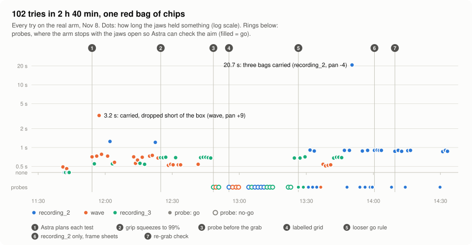
</picture>

<p>
  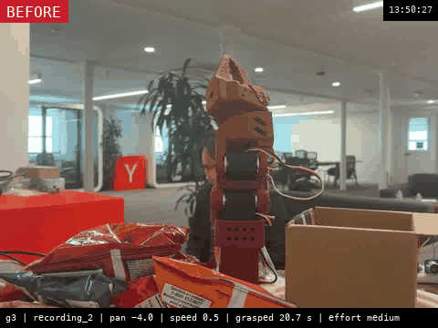
  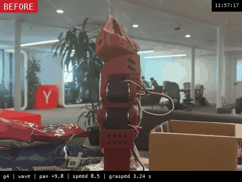
</p>

| | |
|---|---|
| Tries | 102 between 11:41 and 14:33: 70 full pick-and-places and 32 probes |
| One try | about 69 s: 38 s of arm motion, 27 s of Astra planning, 5 s for camera, SSH and logging |
| Longest grip | 20.7 s: `recording_2` at pan −4, three bags (it never let go, below) |
| Closest to the box | `wave` at pan +9 held 3.2 s and dropped the bag just short |
| Probe go rate | 0 of 18 with "a jaw must show under the edge"; 14 of 14 with "the jaws reach the edge" |
| Red bag in the box | 0 |

**The loop.** `python -m armsim.gentest run --guide hermes` on the Mac. The Pi side is `gentest trial`, and the arm host is stopped while the loop runs.
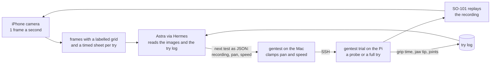
The method changed through the afternoon (the numbers on the timeline):
1. Astra plans each test.
2. The grip squeezes to 99%.
3. A probe before the grab: the arm stops with its jaws open at the grip point, and Astra says go or no-go from the camera.
4. A labelled grid on every frame, so Astra names cells ("jaws F8, edge E8").
5. A looser go rule (below).
6. `recording_2` only, with frame sheets.
7. A re-grab check.

### `recording_2` is the motion that grips
<picture>
  <source media="(prefers-color-scheme: dark)" srcset="media/gentest/grip-by-recording-dark.svg">
  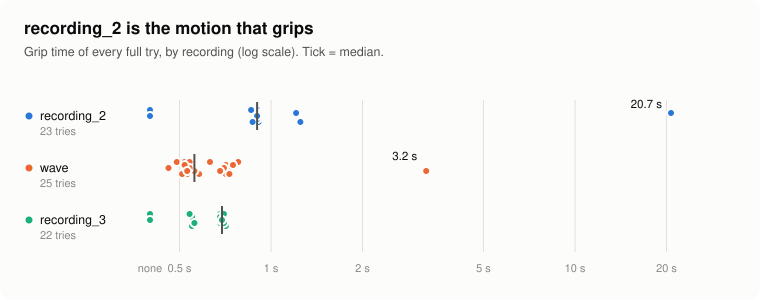
</picture>

`recording_2` closes its jaws lowest, about 2 cm above the table. Every Astra-planned try with it held at least 0.86 s; the two near zero are from the fixed list that ran before Astra. Once the search narrowed to it, Astra fine-tuned the pan in half-degree steps:

<picture>
  <source media="(prefers-color-scheme: dark)" srcset="media/gentest/recording2-pan-dark.svg">
  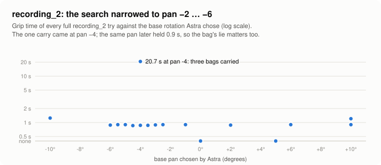
</picture>

A grip time near 0.9 s turned out to be the jaws closing, not a hold. Only the frame sheets (below) tell a slip from a carry.

### Why it never reached the box
<picture>
  <source media="(prefers-color-scheme: dark)" srcset="media/gentest/jaw-heights-dark.svg">
  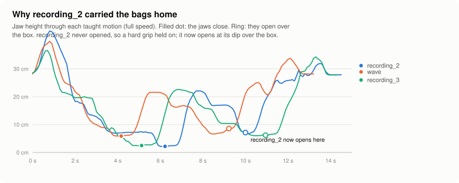
</picture>

- **Where it fell apart:** `recording_2` swings over the box like the other two, but Andre's recording never opens its jaws. It closes them only to about 31 of 100, a grip loose enough that a bag could slip out over the box. Then the loop started squeezing every grip to 99%, so the 20.7 s try held all three bags all the way home, until the gripper reported an overload (alarm 32).
- **The fix:** `gentest` now opens `recording_2`'s jaws at its dip over the box, 10 s in (`DROP_AT`). That fix hasn't had a successful carry to prove it yet.

### Where the jaws went
<picture>
  <source media="(prefers-color-scheme: dark)" srcset="media/gentest/jaw-map-dark.svg">
  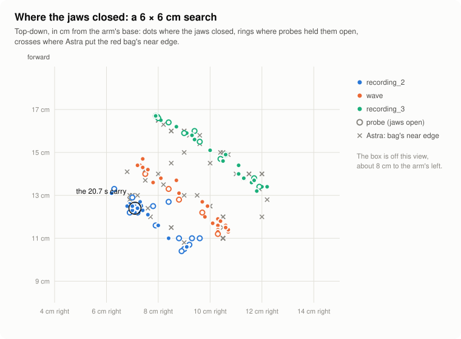
</picture>

Turning the base moves each recording along its own diagonal, and all three stay inside a 6 × 6 cm patch. Astra's estimates of the bag's near edge (crosses) moved as each try pushed the bag around.

### What Astra sees
<p>
  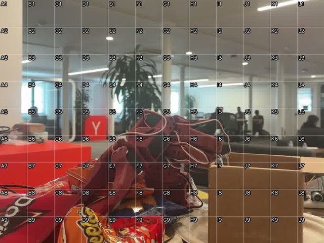
  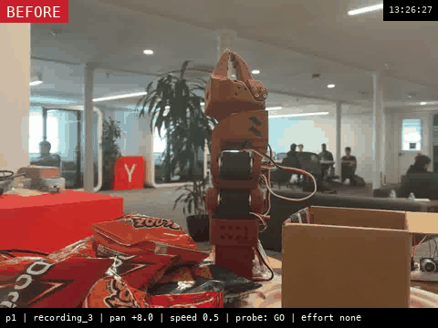
</p>

**The probe frame** (left). This is the shot Astra judged GO at 13:26 (right): the jaws are held open at the grip point, with the grid it names cells by.
- **The strict rule failed:** "a jaw must show under the edge" was never met, 0 of 18. A camera at table height can't see under the bag.
- **The looser rule:** "the jaws reach the edge, low enough to tuck under" said go 14 of 14 times.

From 13:58 on, the camera also took a frame every 4 s through each full try. Astra got these as one timed sheet per try; here are two of those tries as animations:

<p>
  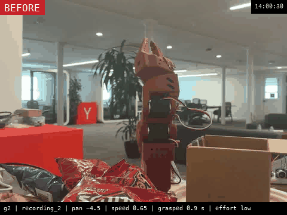
  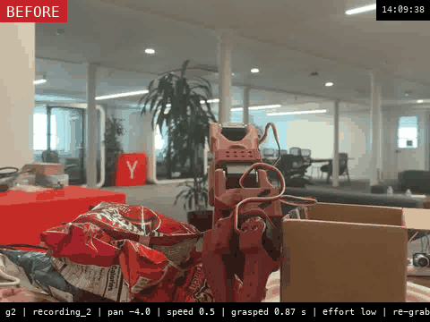
</p>

- **14:00:30 (left).** A whole try: the jaws close on the bag between 16 and 20 s and come up empty, the bag stays in the pile, and the arm swings over the box anyway.
- **14:09:38 (right).** The re-grab check (7). After the grab, the arm holds just above the pile and reads the gripper. Each time it judged the jaws empty, it re-grabbed with a small base nudge (+1.5°, −1.5°, +3°). It never judged one held, so it never carried; it misread thin edge grips as empty and was switched off.

### Where the time goes
<picture>
  <source media="(prefers-color-scheme: dark)" srcset="media/gentest/time-split-dark.svg">
  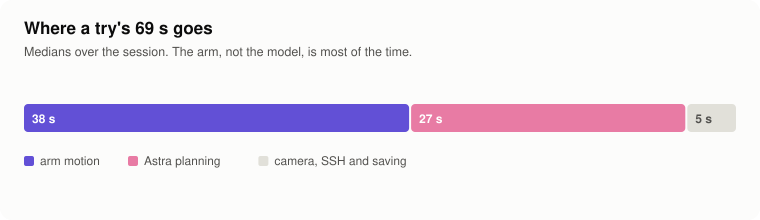
</picture>
<picture>
  <source media="(prefers-color-scheme: dark)" srcset="media/gentest/planning-time-dark.svg">
  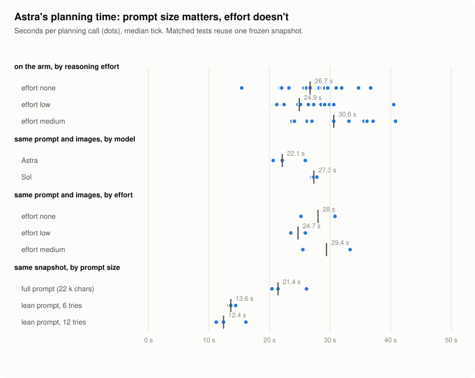
</picture>

- **Reasoning effort didn't matter,** on the arm or in matched tests on one frozen snapshot.
- **Prompt size did:** a lean prompt cut planning from 21 s to about 13 s (`--lean`). Sol was slower than Astra and less consistent.

### What to fix next
- **The servo power.** The servo bus dropped out three times, starting with motor 1, and twice it left the arm hanging mid-move: once slumped over the pile, once over the box. Secure the supply and its connector before anything else.
- **A real "holding" signal.** The gripper's position and load read the same for a thin edge grip and an empty one. The re-grab check (7) opened the jaws on good grabs.
- **The camera.** It sits at table height, so it can't see a jaw under the bag. Mount it higher or add a second one.
- **The motion.** Teach a recording whose jaws straddle the bag's rim, or give the planner a small lift or wrist offset, inside safe limits.

**The data stays local.** The raw try log, 400+ camera frames, Astra's exact prompts and replies, and 102 per-try GIFs are in `data/hackathon-2026-11-08/` on James's Mac, and git ignores them. To redraw this section's media from it:
```
PYTHONPATH=. .venv/bin/python -m armsim.report                            # the charts
PYTHONPATH=. .venv/bin/python -m armsim.gifs --tries 14:00:30 14:09:38    # the try animations
PYTHONPATH=. .venv/bin/python -m armsim.gifs --stories                    # the sim story GIFs (media/sim/)
```

## Everything together, in one place
**Setup:** once per machine, after the setup below, add the Romulus client to this venv:
```
uv pip install --python .venv/bin/python -e ../../packages/contracts -e ../../tools/fake_device
(cd ../.. && uv sync --all-packages)          # the edge bridge's env
```

**Start and stop:**
- `demo/up.sh [--gif]` starts:
  - Romulus (Docker, `make up` + `make seed`, if it isn't up);
  - `pod-1` registered as a sensor pod;
  - the arm host, with a virtual pod and Olir's `podd`, reporting as `arm-twin-1`;
  - Kent's edge bridge.
- `demo/down.sh` stops them, except Romulus (run `make down` from the repo root to stop it).

**The stories** (`PYTHONPATH=. .venv/bin/python -m armsim.stories …`):

| Command | What happens |
|---|---|
| `a` (`--image 07` or `02`) | A bad pod image goes out. Image 07, the bench demo's fault (#54), truncates the distance math. The approach sees "reads 12 mm where the pose says 110 mm" and parks; podd flags `us_mismatch`. The pod healer rolls back (a stand-in in sim). The check at home passes and the arm resumes. |
| `b` | A stuck sensor mid-job: "Distance stuck at 130 mm while the arm moved 29 mm". The arm parks, the sensor restarts through podd, the job retries. |
| `b --hermes` | The same, but the job is a new Naïve board card and Hermes does it, ending with `RESULT:` on the card. |
| `stall` | A dead elbow servo: a checked retry fails, the incident is handed to a person (`hardware`), and Romulus opens a work order. |
| `redo` (`--manager fake`) | A wrong action (sim only): the block is bumped and the grasp misses. The arm reverses, the manager corrects the approach (±40 mm, never joint angles), and the arm redoes it; after two misses it goes to a person. |

<p>
  
  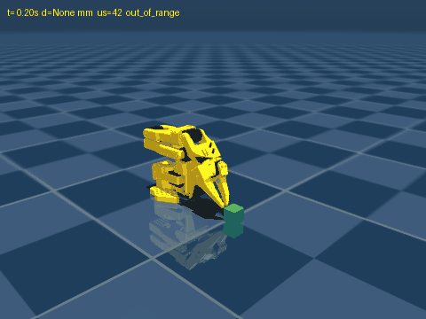
  
</p>

The stories in the sim twin: `a` (left), `b` (middle) and `stall` (right). The yellow line is the pod's ultrasonic beam to the green block, and the status line at the top shows the distance and why the arm parked.


**The autonomous loop, Mission Control and the healer's manager** (all `PYTHONPATH=. .venv/bin/python -m …`, with the arm host up):

| Command | What it does |
|---|---|
| `armsim.orders add pick\|wave\|wave_any --board naive` | Places an order: an `ARM JOB ord-…` card on the Arm jobs board (`--board file` uses `runs/board.json`); `wave` packs the red bag of chips, `wave_any` any one bag |
| `armsim.dispatch --board naive --exec hermes` | Claims each order card, has Hermes do it, and closes or blocks the card. One dispatcher per arm (lock next to the arm host's socket) |
| `armsim.dispatch --board file --exec scripted --manager fake\|hermes [--wrong-action redo]` | The scripted commander, healing through the worker → manager loop (`armsim/worker.py`, `manager.py`, `escalation.py`): plain code checks the manager's one-action plan against an allowlist, and reads the host again just before it runs it. `--manager hermes` won't start, and the manager isn't asked, unless its `/v1/toolsets` shows delegation on and nothing but memory and skills beside it, each with only its own tools (checked at startup and before every ask). A manager `park` or `handoff_human`, a refused unsafe plan and a redo that gives up hand the arm to a person, and that sticks: the host holds a handed-off incident, never moves the arm for it on its own (not even when the pod heals), and the next order waits until a person's check at home closes it; a `pod_rollback` plan runs as a wait for the pod's own healer (recorded `wait_for_pod`). `--worker-lm ollama --worker-model lfm3:1.7b` adds the small model (`workerbench/RESULTS.md`) |
| `armsim.soak run --board naive --with-dispatcher hermes --every 600 --hours 4` | The soak: an order every 10 min, half with a planted fault, and a report (`SOAK.md`) |
| `armsim.camserve` | On the Mac with the bench camera (`127.0.0.1:8790`): `/latest.jpg` and `/eye.json` for Mission Control's split view (twin + live camera, `V` toggles; `?cam=URL` points elsewhere) |
| `armsim.mission --board naive` | Mission Control on `http://localhost:8765/?look=mission\|neon\|light`: the 3D twin, the story banner, jobs, the commander feed, the heal timeline, the pod and the fleet, plus presenter buttons (hotkeys 1–9) |
| `armsim.level3 train` / `audit runs/<run>.jsonl` | Healer level 3: the run-audit classifier (`docs/healer-data-levels.md`) |

The manager is a Hermes profile on James's Mac: `hermes-manager/README.md`. The design is `docs/worker-manager-healer.md`.

<p>
  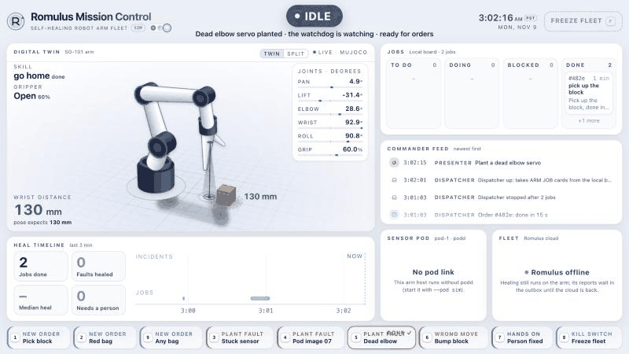
  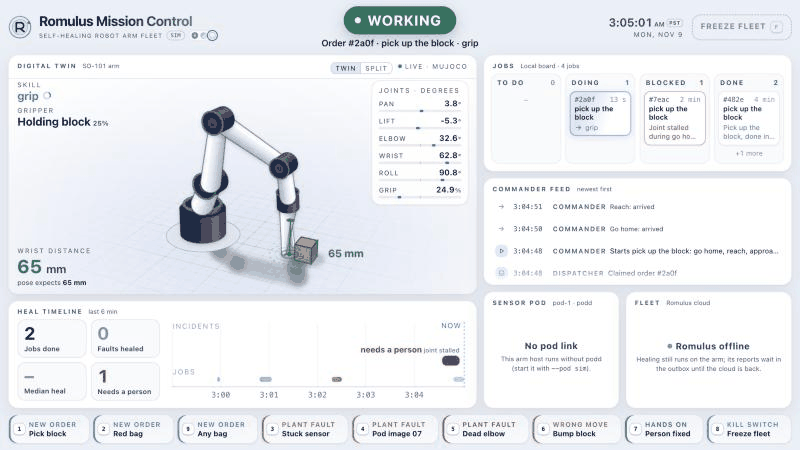
  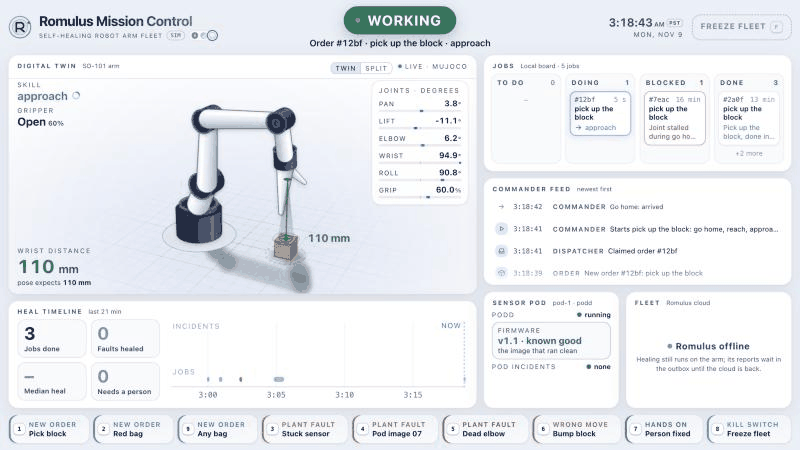
</p>

Mission Control in the sim, recorded from `armsim.host --realtime`, `armsim.mission --board file` and `armsim.dispatch --board file --exec scripted`, with these extras:
- **Dead elbow:** key 5 plants it, key 1 places an order, and key 7 is "a person fixed it".
- **Wrong move** (dispatcher `--manager fake --wrong-action redo`): key 6 bumps the block 30 mm, and key 1 places an order. The grasp misses, so the arm reverses, the stand-in manager says relocate and redo, plain code checks the shift (±40 mm), and the arm redoes the grip: REDONE in 28 s.
- **Stuck sensor** (host `--pod sim --var "$TMPDIR/armsim-pod"`, a short path because podd's socket path has a length limit): key 1 places an order, and key 3 freezes the distance reading mid-job. The watchdog parks the arm on 39 identical readings, a scripted heal restarts the sensor, and it's HEALED in 6.5 s with no person.

<details><summary>A plain pick order, with nothing broken</summary>

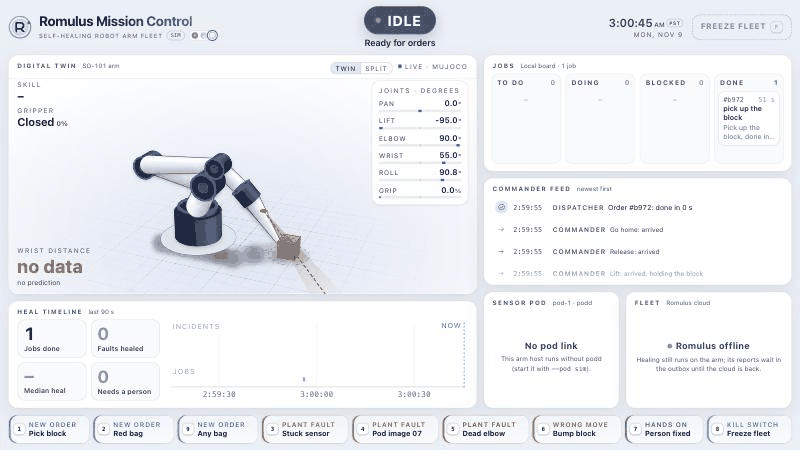
</details>

**What each piece does:**
- **The watchdog** (`host.py`) speaks one sentence, parks the arm, and closes an incident only after `verify()`: home, fresh readings, and podd agreeing. Pod incidents park the arm too.
- **The arm reporter** (`romulus.py`) sends a check-in every 10 s, plus one incident report (and a `log_window` recording) per incident once it is over.
- **Hermes** reads the board through `naive_board`, a filter in `~/.hermes/config.yaml` that exposes only the five card tools.

**The real arm** (`armsim/real.py`):
- `RealArm` wraps Andre's `prims.Arm` (arm/arm.env, the checked-in calibration).
- It moves between the poses taught on the arm (`arm/bin/prim-record.sh --pose rest home above_block pick`).
- Until `armsim/real_calibration.json` holds measured joint offsets, IK and the distance prediction stay off, so only these checks run:
  - frozen sensor;
  - joint stall;
  - podd's own incidents.
- Run it on the Pi with podd up:
  ```
  ARMSIM_ROMULUS=http://<mac-ip>:8000 demo/up.sh --real
  ```
  Then run the stories with `--real`, where faults are planted by hand.
- The adapter's mock tests: `PYTHONPATH=. .venv/bin/python tests/test_realarm.py`.

**Setup, once:**
1. `./setup.sh` fetches MuJoCo Menagerie's SO-101 into `vendor/`.
2. `uv run --python 3.12 --with-requirements requirements.txt python -m armsim poses` writes the poses and the wave.

**Run:** `uv run --python 3.12 --with-requirements requirements.txt python -m armsim <command>`
- `demo` goes home, waves, and goes home again. It writes `runs/<id>.jsonl` (an `arm-run/v1` record) and `runs/<id>.gif`.
- `view` shows the same moves in MuJoCo's viewer.

**To watch it live on macOS:** the viewer needs `mjpython`, and `mjpython` needs a Python with a shared `libpython`. `uv`'s standalone Python doesn't have one, so make a venv once from your framework or conda Python:
```
uv venv --python "$(command -v python3)" .venv
uv pip install --python .venv/bin/python -r requirements.txt
```
Then run `.venv/bin/mjpython -m armsim.host --view`. That opens the arm host with a live window, paced to real time.

**Commander (Hermes):**
1. Start the arm host:
   ```
   uv run --python 3.12 --with-requirements requirements.txt python -m armsim.host --gif
   ```
   Add `--view` (with `mjpython`) to watch it live.
2. Link the plugin: `ln -s "$PWD/hermes-plugin/so101-arm" ~/.hermes/plugins/so101-arm`.
3. Enable it: `hermes plugins enable so101-arm`.
4. Send a command: `hermes chat -q "wave, then go home" --oneshot -t so101_arm`.

The plugin's tools ask the host to run one skill each; the LLM never sends joint angles. Its `pre_tool_call` guard blocks motion while a fault is open or a servo reports an alarm. The host listens on `$TMPDIR/armsim.sock`; set `ARMSIM_SOCK` to change that.

**Watchdog (level 1, plain code):** `armsim/level1.py` writes findings in the same shape as Olir's `detect.py`. The rules:
- `us_frozen`: zero echo jitter.
- `us_stuck`: the reading is flat while the arm moves.
- `us_scale` / `us_offset`: the reading disagrees with the kinematic prediction.
- `us_noisy`: too much jitter while the arm is still.
- `us_missing_echo`: no echo where the pose says a surface is in range.
- `joint_stall`: a move that didn't arrive.

The first finding speaks its sentence (`say`; `ARMSIM_SPEAK=live|file|off`), halts and parks the arm, and blocks motion until a repair is verified.

**Fault factory:** `python -m armsim.factory --n 1000 --workers 8` runs labeled sim runs with planted faults, about 0.1 s each across 8 cores. It writes `arm-run/v1` files plus `index.jsonl` to `data/sim-faults/`, and prints which faults level 1 caught.

**Level 2:** `level2/chatts_test.py` asks ChatTS-14B whether it spots a frozen copy of the pod's ultrasonic sample. `level2/run_on_pod.sh` runs it on a RunPod GPU with a 2-hour cap and then stops the pod.

**Units and formats:**
- Arm joints are in degrees and the gripper is 0–100 (0 = closed), the same as LeRobot and Andre's primitive JSON.
- Distance rows use the pod's `D` fields (`mm`, `us`, `st`).

**Known limits:**
- The sim's zero pose isn't the real arm's calibrated zero.
- Pointing straight down, the fingertips can't rise above about 9 cm at 0.17–0.25 m out, because wrist flex tops out near 95°. That's why the block is 3 cm tall.
