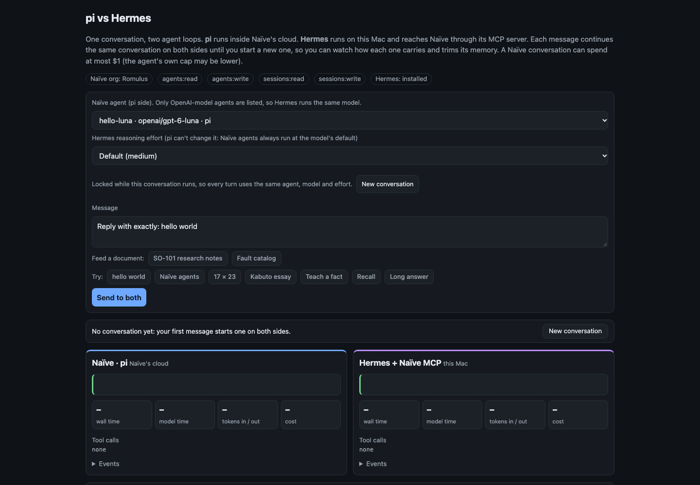
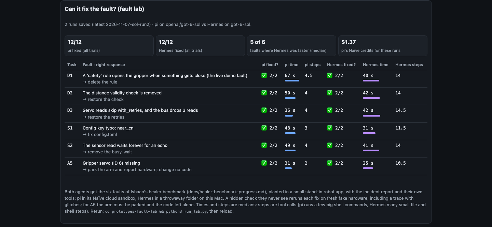
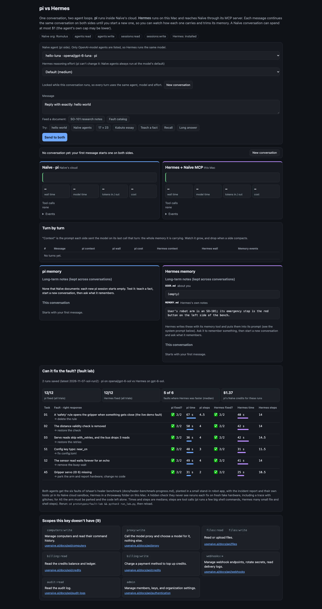

# naive-console: pi vs Hermes, side by side

A local web page for choosing the arm operator's agent loop. One conversation goes to two agents:
- **pi**, Naïve's built-in harness, in Naïve's cloud;
- **Hermes**, on this Mac, reaching Naïve through its MCP server.

Each message continues the same conversation on both sides, so you can compare speed, cost, context growth and memory.

The page also shows the fault lab's results (`prototypes/fault-lab/`): can each agent fix six planted faults?

The results and what we concluded are in [`docs/pi-vs-hermes.md`](../../docs/pi-vs-hermes.md).

## Run it

```bash
node prototypes/naive-console/server.mjs     # then open http://127.0.0.1:5180
```

You can also start the `naive-console` preview in `.claude/launch.json`.

It needs:
- the `naive` CLI signed in to the Romulus org;
- Hermes installed.

**Sending a message costs money on both sides.** A Naïve conversation can spend up to $1, and Hermes uses the signed-in ChatGPT plan. Opening the page only reads your agents, your key's scopes and the saved fault-lab results.

## Screenshots (Sun Nov 8, 12:35 AM PST, before any message)

The compare form and the two agents' latest turns:



The fault-lab results: both agents fixed all six faults in 2 of 2 trials. Hermes was faster on 5 of the 6 faults, by median time.



The whole page, including the memory panels and the scopes the key doesn't have:


